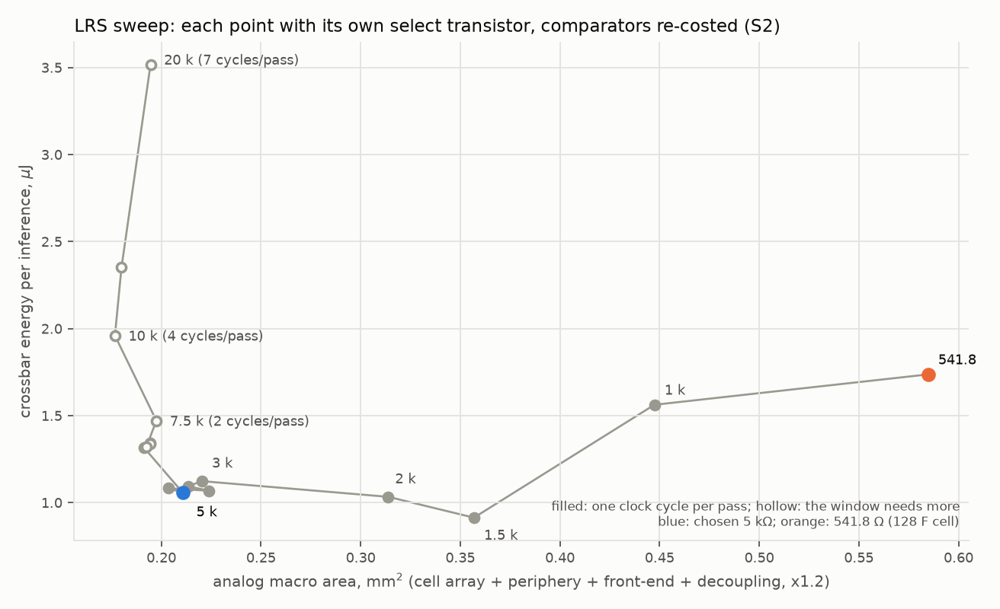

# Operating-point sweep, comparators and the smaller die - second optimisation pass

> **Superseded for area and energy by `final_design.md`.** The 0.355 mm^2 die and the "area target met" claim below are **wrong**: the 5 kohm macro was modelled at 0.211 mm^2 and with the corrected decoupling rule it is about 0.51 mm^2 (die about 0.66 mm^2). The crossbar sweep tables are still valid at the model level.

Open-source tools only (Yosys, OpenROAD, OpenSTA, ngspice, NeuroSim). Tags: **[RTL]** measured on the RTL regression, **[LAYOUT]** OpenROAD detail-routed, **[POWER]** OpenSTA on the activity file of a gate-level simulation of that detail-routed netlist (zero-delay: **glitch power excluded**; one sample, row 46, timestep 10; ingest window 2,400 cycles from cycle 44,339, scan window 1,258 cycles from cycle 47,237; **100 % of the pins annotated** in every run, both libraries), **[1F]** ngspice, **[NSIM]** NeuroSim, **[MODEL]** analytic in code, **[ASSUM]** assumed.

**Power caveat, applies to every energy and power comparison in this report:** power is energy divided by latency, and NeuroHDC-small's samples are not the same length as ours (about 180k cycles for NeuroHDC, 310,860 cycles here for the early-exit design and 529,486 without early exit, on 407k events), so power is **not** like-for-like. **Energy per inference is the primary figure.** Exclusions, windows and the comparison basis are those of `final_ppa.md` and `optimised_ppa.md`, unchanged.

## 0. The answer

| | NeuroHDC-small | previous pass (`optimised_ppa.md`) | **this pass, full design** |
|---|---|---|---|
| energy per inference | 3.01 uJ | 4.29 uJ as reported; **4.80 uJ** when the 541.8 ohm macro is evaluated consistently (section 1) | **3.91 uJ** (1.30x) |
| die area | 0.399 mm^2 | 0.741 mm^2 | **0.355 mm^2** (0.89x) |
| average power (energy / latency, not like-for-like) | about 1.67 mW (3.01 uJ over about 180k cycles) | 1.38 mW | 1.26 mW over 3.11 ms |
| accuracy, DVS-Gesture, full design | | 80.42 % | 80.42 % (unchanged, section 4) |
| timing, detail-routed | | closed | slow setup +0.238 ns, hold +0.161 ns; fast +3.511 / +0.124 ns; TNS 0 in both corners |

**The area target is met: 0.355 mm^2 against 0.399 mm^2 (11 % below). The energy target is missed: 3.91 uJ against 3.01 uJ, 0.90 uJ (30 %) over.** The chosen operating point is **LRS = 5 kohm** (13.9 F x 4 F cell, select transistor 1.5 um wide, 366 ohm): it sits on the energy plateau (within 3 % of the minimum, the 1.5 kohm point) and, with 4.5 kohm, has the smallest macro whose integration windows still fit one clock cycle per pass (section 1.2). Against the 541.8 ohm macro evaluated on the same footing the energy is 19 % lower (4.80 -> 3.91 uJ) and the die 52 % smaller (0.741 -> 0.355 mm^2).

Three corrections to the previous pass came out of doing the sweep consistently; they change what it reported and are stated first because the comparisons above depend on them.

1. **The 541.8 ohm macro was evaluated with the wrong select transistor.** The area and the write path assumed the 128 F cell (a 13.8 um wide, 40 ohm transistor), but the read-path mesh, the front-end noise, the array energy and the row-line study all used the 20 F^2 cell's 1016 ohm transistor. With the 128 F transistor the read currents are 2.7x larger, the row line carries them, and **the row-line gain spread is 28 % and the rank-0 residual 9.5 % (budget 4.24 %): the threshold correction cannot be deleted (rank 1 is needed), which reverses item 7's conclusion for that macro**. The word line also carries 25.6x the gate capacitance. Evaluated consistently the 541.8 ohm crossbar costs 2.02 uJ (1.74 with the comparators of S2), not 1.22 uJ, and the chip 5.09 (4.80) uJ, not 4.29 uJ.
2. **The 40 kohm result in `operating_point.json` is withdrawn.** Its front-end noise was computed in a process that had already run other points and carried stale array resistances (a fresh run of the same function gives 0.0306 uA at 64 ns, the stored value is 0.123 uA). Re-run with a fresh process per point, and with the noise requirement tied to the original 1F design's decision error rate (the basis item 9 uses), 40 kohm is not viable at any window up to 64 ns.
3. **The noise requirement is now the algorithm's, not each cell's own.** Item 9 relaxed a per-plane noise requirement relative to the original 1F design at 541.8 ohm / 20 F^2 (relative noise 0.0116 of the level step at vb 0.5 V, T = 1 ns); here every point has to meet that same requirement x its plane's relaxation, so accuracy is held fixed by construction instead of being whatever each cell happens to give.

## 1. S1 - the operating-point sweep

**Method.** For each LRS (19 values, 541.8 ohm to 40 kohm, log-spaced with a finer grid between 3 and 7 kohm) the whole analog chain with that point's own select transistor (`scaleup/op_sweep.py`, `op_sweep_report.py`, NeuroSim `run_sweep.py`):
- **Transistor and cell.** The SET compliance current an LRS state needs is the device's current at the SET voltage, which in this device model scales exactly with the state's conductance (I(V, gap(R)) x R is the same function of V for every R, checked to 4e-5 relative). The write path fixes 128 F at 541.8 ohm, so the cell is w = max(5, 128 x 541.8 / R) F wide and 4 F high (5 F = the 20 F^2 minimum cell); 1A's width rule gives the transistor width and R_tx x W = const its resistance [MODEL, from the 128 F of 1D]. NeuroSim accepts every one of these cells (its own minimum, 39.8 F at 541.8 ohm, is always smaller).
- **Levels.** Step and the largest sigma_lnG at which 5 sigma of the device spread stays inside half a step (grid 0.02 to 0.15).
- **Row line.** Metal9 strapped at its 0.18 um minimum width (0.119 ohm/um, as item 7), x the cell width; gain matrix over the same (group, cell, active rows) grid as item 7; rank-0..3 residuals; the budget a row-gain error may use is 4.24 % of full scale at the 541.8 ohm point scaled by what the device spread leaves of the half step at sigma_lnG = 0.05.
- **Front-end.** The 1F conveyor front-end in ngspice with this array behind it (branch = R_tx + R_device): noise vs window (0.5 to 64 ns), collected step ratio, idle current, power-up, for five bias points.
- **Energy.** Items 8 and 9 applied at every point: each of the 8 weight planes takes the cheapest (vb, T) whose relative noise stays within its relaxation of the original 1F design's; boosted wake-up (ramp x 0.73) and 40 shared channels (ramp paid once per read per channel); array energy scaled with the branch current x T and word-line energy with the transistor width; threshold correction at the lowest rank that fits the budget; comparators before and after S2 (section 3).
- **Area** = 1.2 x (5 x NeuroSim array + 5 x NeuroSim periphery + front-end + decoupling). Front-end 0.1052 mm^2 at 160 channels (1F 'mid'), re-costed in S2; decoupling = 0.1667 mm^2 x peak supply current / the 1F design's [MODEL]. The 40-shared-channel column assumes the 160 columns share 40 channels through an analog mux (10 um^2 per column [ASSUM]); that front-end has not been designed.
- **Window and clock.** A pass takes ceil((T + 0.3 ns tail + 1.0 ns margin) / 10 ns) cycles; **windows up to 8 ns fit the 100 MHz clock with no change to the RTL**, longer ones need wait cycles the RTL does not have, so those points are model-only.

| LRS (ohm) | cell | R_tx (ohm) | level step (uA) | sigma_lnG limit | row-gain spread / rank-0 residual | rank | T max (ns) | cycles / pass | sense | array + wl | comparators before / after S2 | threshold | **crossbar uJ before / after S2** | macro mm^2 (160 ch / 40 shared ch) | laid out: digital uJ / die mm^2 / **chip uJ** |
|---|---|---|---|---|---|---|---|---|---|---|---|---|---|---|---|
| 541.8 | 128.0 F x 4 F = 1.037 um^2 | 40 | 338.7 | 0.10 | 28.4 % / 9.52 % | 1 | 1 | 1 | 0.56 | 0.34 | 0.50 / 0.22 | 0.62 | **2.02 / 1.74** | 0.585 / 0.542 | 3.06 / 0.741 / **4.80** |
| 1000 | 69.4 F x 4 F = 0.562 um^2 | 73 | 183.4 | 0.10 | 12.2 % / 4.30 % | 1 | 1 | 1 | 0.59 | 0.20 | 0.50 / 0.15 | 0.62 | **1.91 / 1.56** | 0.447 / 0.411 | - |
| 1500 | 46.2 F x 4 F = 0.374 um^2 | 110 | 121.8 | 0.10 | 6.5 % / 2.36 % | 0 | 4 | 1 | 0.58 | 0.19 | 0.50 / 0.14 | 0.00 | **1.27 / 0.91** | 0.357 / 0.321 | 2.90 / 0.511 / **3.82** |
| 2000 | 34.7 F x 4 F = 0.281 um^2 | 147 | 91.0 | 0.10 | 4.0 % / 1.50 % | 0 | 4 | 1 | 0.70 | 0.18 | 0.50 / 0.15 | 0.00 | **1.38 / 1.03** | 0.314 / 0.278 | - |
| 3000 | 23.1 F x 4 F = 0.187 um^2 | 220 | 60.2 | 0.10 | 2.0 % / 0.78 % | 0 | 8 | 1 | 0.75 | 0.22 | 0.50 / 0.15 | 0.00 | **1.47 / 1.12** | 0.220 / 0.184 | 2.89 / 0.365 / **4.01** |
| 3500 | 19.8 F x 4 F = 0.160 um^2 | 256 | 51.3 | 0.10 | 1.5 % / 0.60 % | 0 | 8 | 1 | 0.75 | 0.19 | 0.50 / 0.16 | 0.00 | **1.43 / 1.09** | 0.214 / 0.177 | - |
| 4000 | 17.3 F x 4 F = 0.140 um^2 | 293 | 44.7 | 0.10 | 1.2 % / 0.48 % | 0 | 8 | 1 | 0.75 | 0.16 | 0.50 / 0.16 | 0.00 | **1.41 / 1.07** | 0.224 / 0.187 | - |
| 4500 | 15.4 F x 4 F = 0.125 um^2 | 330 | 39.6 | 0.10 | 1.0 % / 0.39 % | 0 | 8 | 1 | 0.76 | 0.16 | 0.50 / 0.16 | 0.00 | **1.42 / 1.08** | 0.204 / 0.166 | - |
| 5000 | 13.9 F x 4 F = 0.112 um^2 | 366 | 35.5 | 0.10 | 0.8 % / 0.33 % | 0 | 8 | 1 | 0.77 | 0.12 | 0.50 / 0.16 | 0.00 | **1.39 / 1.06** | 0.211 / 0.173 | 2.85 / 0.355 / **3.91** |
| 5500 | 12.6 F x 4 F = 0.102 um^2 | 403 | 32.1 | 0.10 | 0.7 % / 0.28 % | 0 | 16 | 2 | 0.96 | 0.19 | 0.50 / 0.16 | 0.00 | **1.65 / 1.32** | 0.191 / 0.154 | - |
| 6000 | 11.6 F x 4 F = 0.094 um^2 | 440 | 29.3 | 0.10 | 0.6 % / 0.24 % | 0 | 16 | 2 | 1.00 | 0.17 | 0.50 / 0.17 | 0.00 | **1.67 / 1.34** | 0.194 / 0.157 | - |
| 6500 | 10.7 F x 4 F = 0.086 um^2 | 476 | 26.9 | 0.10 | 0.5 % / 0.21 % | 0 | 16 | 2 | 0.99 | 0.16 | 0.50 / 0.19 | 0.00 | **1.65 / 1.34** | 0.194 / 0.155 | - |
| 7000 | 9.9 F x 4 F = 0.080 um^2 | 513 | 24.9 | 0.10 | 0.5 % / 0.18 % | 0 | 16 | 2 | 0.98 | 0.15 | 0.50 / 0.19 | 0.00 | **1.63 / 1.32** | 0.192 / 0.153 | - |
| 7500 | 9.2 F x 4 F = 0.075 um^2 | 549 | 23.1 | 0.08 | 0.4 % / 0.16 % | 0 | 16 | 2 | 1.13 | 0.14 | 0.50 / 0.20 | 0.00 | **1.77 / 1.47** | 0.197 / 0.157 | - |
| 10000 | 6.9 F x 4 F = 0.056 um^2 | 733 | 16.9 | 0.08 | 0.2 % / 0.10 % | 0 | 32 | 4 | 1.56 | 0.20 | 0.50 / 0.20 | 0.00 | **2.26 / 1.96** | 0.177 / 0.136 | - |
| 15000 | 5.0 F x 4 F = 0.040 um^2 | 1016 | 10.8 | 0.08 | 0.1 % / 0.05 % | 0 | 32 | 4 | 1.91 | 0.17 | 0.50 / 0.28 | 0.00 | **2.57 / 2.35** | 0.180 / 0.133 | - |
| 20000 | 5.0 F x 4 F = 0.040 um^2 | 1016 | 7.8 | 0.08 | 0.1 % / 0.03 % | 0 | 64 | 7 | 2.95 | 0.20 | 0.50 / 0.38 | 0.00 | **3.64 / 3.52** | 0.195 / 0.140 | - |
| 30000 | 5.0 F x 4 F = 0.040 um^2 | 1016 | 4.8 | 0.06 | 0.1 % / 0.02 % | 0 | 64 | 7 | 7.00 | 0.21 | 0.50 / 0.49 | 0.00 | **7.71 / 7.70** | 0.225 / 0.159 | - |
| 40000 | 5.0 F x 4 F = 0.040 um^2 | 1016 | 3.2 | 0.06 | 0.0 % / 0.01 % | 0 | 64 | 7 | 31.03 | 0.16 | 0.50 / 0.51 | 0.00 | **31.69 / 31.70** | 0.443 / 0.373 | - |

Reading the table. Below about 1.5 kohm the 128 F-class transistor makes the row line carry too much current (rank 1 needed, 0.6 uJ of threshold arithmetic) and the word line expensive. From 1.5 to 5 kohm the correction disappears (rank 0 fits), the windows stay within one cycle and the crossbar sits on a floor of 0.9 to 1.1 uJ. Above 5 kohm the level step falls below what a one-cycle window can resolve to the required error rate: the window (and with it the idle-bias energy) grows with 1/step^2 and the energy climbs steeply. The device-spread limit (sigma_lnG) is 0.10 up to 5 kohm and falls to 0.08 and 0.06 above it; the chosen point closes at sigma_lnG 0.10 (fails at 0.12), which covers the single-read program-verify floor (0.079) with margin, and no point in the table is chosen at a limit below 0.08. Point-to-point differences below about 0.05 uJ in the 3 to 5 kohm plateau are inside the model's resolution.

### 1.1 Measured digital block at the laid-out points

Each point was synthesised once (the digital netlist does not change), floorplanned with its own macro, placed, clock-tree-synthesised, global- and detail-routed in one OpenROAD session with both corners checked, and powered from the gate-level activity of the routed netlist. The power of a layout whose slow-corner setup was open is not quoted: the 1.5 kohm layout at util 0.40 left slow setup at -1.48 ns and is not in the table (it was redone at util 0.38). All four points below close setup and hold in both corners with TNS 0.

| LRS | cell | macro mm2 | die mm2 | ingest / scan mW | digital uJ | crossbar uJ (before / after S2) | total uJ (before / after S2) | slow setup / hold | fast setup / hold | residual DRC | sigma_lnG limit |
|---|---|---|---|---|---|---|---|---|---|---|---|
| 541.8 | 128.0 F | 0.585 | 0.741 | 0.543 / 2.46 | 3.06 | 2.02 / 1.74 | 5.09 / 4.80 | +0.040 / +0.153 | +3.581 / +0.150 | 18 | 0.10 |
| 1500 | 46.2 F | 0.357 | 0.511 | 0.480 / 2.44 | 2.90 | 1.27 / 0.91 | 4.17 / 3.82 | +0.485 / +0.157 | +3.529 / +0.150 | 41 | 0.10 |
| 3000 | 23.1 F | 0.220 | 0.365 | 0.493 / 2.38 | 2.89 | 1.47 / 1.12 | 4.36 / 4.01 | +0.405 / +0.152 | +3.503 / +0.146 | 16 | 0.10 |
| 5000 | 13.9 F | 0.211 | 0.355 | 0.486 / 2.35 | 2.85 | 1.39 / 1.06 | 4.24 / 3.91 | +0.238 / +0.161 | +3.511 / +0.124 | 26 | 0.10 |

Digital energy **barely depends on the macro width**: 3.06 uJ at the 765 um strip of the 541.8 ohm macro, 2.85 to 2.90 uJ at 460 to 600 um. The subtraction the brief expected from a shorter strip is real but small (5 to 7 %), because the buffers that dominate scan power are not width-driven (section 5).

### 1.2 The knee

Energy first, then area. No point reaches 3.01 uJ: the digital block alone is 2.85 to 3.06 uJ. Taking the energy-optimal point (1.5 kohm, 3.82 uJ) costs a 0.511 mm^2 die; the 5 kohm point is +0.09 uJ (+2.4 %) for -0.156 mm^2 (-31 %), and it meets the area target. **The knee is 4.5 to 5 kohm; I chose 5 kohm** (laid out, closed, powered; 4.5 kohm is 0.01 mm^2 smaller in the macro and 0.03 uJ dearer in the crossbar and was not laid out). If energy alone decides, the 1.5 kohm point is the one to take.

## 2. Chip numbers at the chosen point, all four builds [LAYOUT][POWER]

Digital = ingest-window power x events ingested + scan-window power x the remaining cycles (RTL regression means, 720 samples), fast library, as before; crossbar = the sweep's energy per non-zero read at 5 kohm (comparators after S2) x that build's reads; the factorization-off builds carry the 338 x 340 um class array and the full-width cell band above it (die 0.498 mm^2, not the minimum for those builds).

| build | accuracy | exit t | cycles | latency ms | digital uJ (fast / slow) | crossbar uJ | other | **energy uJ** | avg power mW | die mm2 | slow setup / hold | fast setup / hold |
|---|---|---|---|---|---|---|---|---|---|---|---|---|
| full | 80.42% | 57.6 | 310,860 | 3.11 | 2.85 / 2.01 | 1.06 | 0.0036 | **3.91** | 1.26 | 0.355 | +0.238 / +0.161 | +3.511 / +0.124 |
| ee_off | 80.42% | 100.0 | 529,486 | 5.29 | 5.01 / 3.52 | 1.80 | 0.0061 | **6.81** | 1.29 | 0.349 | +0.631 / +0.152 | +3.694 / +0.150 |
| fact_off | 82.36% | 60.7 | 325,340 | 3.25 | 3.00 / 2.10 | 1.11 | 0.0121 | **4.12** | 1.27 | 0.498 | +0.951 / +0.156 | +3.716 / +0.150 |
| both_off | 82.36% | 100.0 | 529,486 | 5.29 | 4.71 / 3.31 | 1.80 | 0.0198 | **6.52** | 1.23 | 0.498 | +0.644 / +0.154 | +3.709 / +0.150 |

Annotation 100 % and the gate-level run reproduces the RTL golden outputs for every build and window. Residual detail-route DRC: full 26 (26 metal spacing), early-exit-off 12 (12 metal spacing), factorization-off 0, both-off 0; all are metal spacing next to a macro edge (section 8, item 1) and none touches timing. (The early-exit-off layout closes at util 0.42; at util 0.40 it left slow setup at -0.39 ns and is not used.)

**Against 3.01 uJ and 0.399 mm^2:** full design 3.91 uJ / 0.355 mm^2; factorization off 4.12 uJ / 0.498 mm^2 (area target missed by the 0.115 mm^2 class array); the early-exit-off builds (6.81 and 6.52 uJ) are the ablation, not candidates. The ranking of the builds is unchanged from `optimised_ppa.md`.

### 2.1 What the gap is made of (full design, 0.90 uJ over 3.01)

| term | uJ | of which |
|---|---|---|
| digital, ingest | 1.16 | 0.486 mW x 239,149 event cycles; clock tree 34 %, counter SRAM + class array 30 %, logic 28 % |
| digital, scan | 1.69 | 2.35 mW x 71,712 cycles; logic 35 %, wire-repair buffers 29 %, clock tree 26 %, load-slew / hold / fanout buffers 7 % |
| crossbar sense bias | 0.77 | idle bias of the front-end over 4 to 8 ns windows and the ramp |
| crossbar comparators | 0.16 | 9.8 pJ per read after S2 (29.8 before) |
| crossbar array + word line | 0.12 | |
| level shifters + class arrays | 0.004 | |
| **total** | **3.91** | target 3.01 |

The digital block is 73 % of the energy and 2.85 uJ of it is already close to the whole 3.01 uJ budget: **meeting 3.01 uJ at this crossbar would need the digital block at about 1.95 uJ (32 % lower), i.e. all three scan terms (logic, buffers, clock) and the ingest clock tree cut by about a third at once**. The crossbar, after the sweep and S2, has little left to give (the comparators were the only fixed term and are down to 0.16 uJ); the largest crossbar term is the sense bias at 0.77 uJ.

## 3. S2 - the comparators

1F's comparator energy per comparison is preamplifier 16.8 fJ + latch 10 fJ + **threshold capacitor array 100 fJ [ASSUM]**, x 1.47 comparisons per column read (binary search at g = 4) x 160 columns = 29.8 pJ per non-zero read, 0.50 uJ per inference, 41 % of the crossbar in the previous pass and untouched by it. The array also carries the largest single per-column area, 250 um^2 of the front-end's 524 um^2.

- **(a) The correction deleted.** With the row-gain correction static (rank 0, which every point from 1.5 kohm up satisfies) the thresholds sit at fixed level midpoints chosen by the shared per-group ladder, and the per-column array only has to trim what the ladder cannot: the rank-0 residual plus the per-column calibration residual (6.3 uA at 5 sigma, 1F budget `closure_map.json`). 1F's budget shows the threshold generation term is small against the others at the design point (ladder quantisation 0.05 uA, threshold generation 0.86 uA, against front-end noise 7.1 uA and calibration residual 6.3 uA of a 9 uA margin), so a 10-bit array was far finer than needed.
- **(b) Per plane.** The array is sized so its LSB is half the front-end noise at the (vb, T) that plane uses: bits_k = ceil(log2(trim range / (sigma_k / 2))); a capacitor array's switching energy scales with 2^bits, so E_dac = 100 fJ x 2^(bits - 10) + 3 fJ for the ladder select [ASSUM]. At 5 kohm the planes need **6, 7, 7, 7, 7, 7, 7, 7 bits** (against 9 for a full-range array at the same noise).
- **(c) Binary search.** The mean 1.47 comparisons per read is set by the distribution of active rows, not by plane tolerance: a plane that tolerates a 0.9 % decision error still needs every decision it makes, so no comparison can be dropped; no reduction is claimed.

**Result at 5 kohm: comparators 0.500 -> 0.164 uJ (29.8 -> 9.8 pJ per read), crossbar 1.393 -> 1.057 uJ.** The front-end also shrinks: the threshold array falls from 250 to about 29 um^2 per column, 0.1052 -> 0.070 mm^2 at 160 channels. These two rest on the [ASSUM] capacitor-array scaling and the 6.3 uA trim range; with the full 10-bit array the 5 kohm chip would be 4.24 uJ and the macro 0.253 mm^2.

## 4. Accuracy

The RTL is unchanged since the regression of `optimised_ppa.md` (the repository's HEAD, `git diff` empty over `design/rtl/rtl` and `tb`); every number here is a different analog model, layout or power run of the same digital design, so the functional results are the ones already regressed. Re-confirmed: the smoke check passes, and the four builds at g = 4 and g = 8 (24 runs, 240 samples each, Verilator) were re-run and **are identical to the earlier regression in every sample record (24 of 24 files)**. DVS-Gesture accuracy: **full design 80.42 %, factorization off 82.36 %**; early exit does not change it (80.42 %, 82.36 %).

## 5. S3 - the digital block at the smaller die

Breakdown by what the instance is, fast library, the routed layouts (`opt/instagg.py`):

| group | baseline layout, scan (uW) | 5 kohm layout, scan (uW) | baseline, ingest (uW) | 5 kohm, ingest (uW) |
|---|---|---|---|---|
| logic cells (13615 / 13615 instances) | 796 | 815 | 130 | 135 |
| wire-repair buffers (2338 / 2332 instances) | 706 | 679 | 49 | 26 |
| load-slew buffers (391 / 410 instances) | 111 | 105 | 2 | 1 |
| fanout buffers (48 / 47 instances) | 17 | 18 | 0 | 0 |
| hold buffers (641 / 562 instances) | 96 | 35 | 3 | 7 |
| port buffers (346 / 346 instances) | 1 | 1 | 6 | 4 |
| clock tree (542 / 596 instances) | 656 | 618 | 206 | 166 |
| macros (5 / 5 instances) | 73 | 73 | 147 | 147 |
| other (21 / 55 instances) | 1 | 6 | 0 | 0 |
| **total** | **2456** | **2351** | **543** | **486** |

- **The shorter strip did not shrink the wire-repair buffers**: 2,338 at the 765 um strip, 2,332 at 460 um, scan power 706 -> 679 uW. They are inserted by `repair_design` to keep slews under the **PDK library's own max_transition of 0.28 ns** (1,667 slew violations repaired on the way to 2,385 buffers in 1,426 nets), so they follow the netlist's fanout structure, not the distance to the macro. That limit is the library's and is not relaxed. What the die does give back: the clock tree (scan 656 -> 618 uW, ingest 206 -> 166 uW) and hold buffers (641 -> 562).
- **Gating granularity and utilisation at the new floorplan** (groute stage, same flow, fast library, 100 MHz; the first row is the routed layout of the chosen point and the groute-stage row below it is the like-for-like comparison):

| variant | ingest / scan (mW) | digital (uJ) | slow setup | die (mm^2) | status | note |
|---|---|---|---|---|---|---|
| gate-min 1, util 0.40 (chosen), routed | 0.486 / 2.35 | 2.85 | +0.238 (TNS 0.00) | 0.355 | closed | finest gating, as at 765 um |
| gate-min 1, util 0.40, groute stage | 0.486 / 2.35 | 2.85 | +0.238 (TNS 0.00) | 0.355 | closed | like-for-like with the rows below |
| gate-min 2, util 0.40 | 0.485 / 2.34 | 2.84 | +0.402 (TNS 0.00) | 0.355 | closed |  |
| gate-min 4, util 0.40 | 0.521 / 2.39 | 2.96 | +0.387 (TNS 0.00) | 0.355 | closed |  |
| gate-min 1, util 0.35 | 0.484 / 2.27 | 2.79 | +0.317 (TNS 0.00) | 0.371 | closed | larger die |
| gate-min 1, util 0.45 | 0.494 / 2.45 | 2.94 | -0.329 (TNS -0.97) | 0.343 | NOT closed: no power number quoted | smaller die, does not close |

 The gating granularity that was best at the 765 um strip (gate-min 1) is still best or level; coarser gating loses ingest power as before. Utilisation 0.35 gains about 2 % of digital energy for 4 % more die and was not taken; 0.45 does not close.
- **Digital energy at the new die: 2.85 uJ against 3.06 uJ** (-7 %), 2.01 uJ with the slow library's 0.9 V power.

## 6. S4 - area, and whether 0.2 mm^2 is reachable

Macro parts at 5 kohm (mm^2, before the 20 % overhead): cell array 0.018, row/column periphery 0.027, front-end 0.070, decoupling 0.060; sum 0.176, macro 0.211. **The area is front-end-limited from about 3 kohm up: the front-end is 40 % of the macro at 5 kohm** (15 % at 541.8 ohm, 23 % at 1.5 kohm, 37 % at 3 kohm, 50 % at 10 kohm), because the array and its periphery shrink with the cell and the front-end does not; decoupling is the next largest part and follows the supply current.

What would have to change to shrink the front-end (not done here):
- the 160 per-column channels (conveyor 141, integration capacitors 40, decision 62 um^2 each) to 40 channels shared through an analog mux over the four passes, which is what the RTL's 40 columns per pass and item 8's energy model already assume: the front-end would be about 0.039 mm^2 instead of 0.070 (not designed; mux 10 um^2 per column [ASSUM]);
- the shared ladder and gain storage (17,862 um^2), whose gain-storage half the deleted correction no longer needs (the split is not in the 1F table);
- the decoupling (0.060 mm^2 at 5 kohm), which scales with the supply current the front-end's idle bias dominates.

**Is 0.2 mm^2 (half of NeuroHDC-small's 0.399) reachable without a new front-end? No, and not with one either.** The die at the chosen point is 0.355 mm^2. Floorplans (not routed) for the same digital block: a macro of 0.173 mm^2 (the 40-shared front-end) gives a 0.316 mm^2 die; a macro with **no front-end area at all** (0.127 mm^2) gives 0.268 mm^2 at the routable utilisation of 0.40 and 0.221 mm^2 at an unroutable 0.70. The digital cells (0.042 mm^2) plus the SRAM and class-array macros (0.012 mm^2) are 0.054 mm^2 at perfect packing, and the cell array, periphery and decoupling (0.127 mm^2 with overhead) cannot be removed. Half of NeuroHDC's area therefore needs the front-end, the decoupling and the digital density all several times better than this design, not a new front-end alone. The remaining reachable step is the 40-shared front-end (0.316 mm^2 estimated).

## 7. Comparison with the previous pass, on the same footing

| | previous pass as reported | previous pass evaluated consistently | this pass |
|---|---|---|---|
| cell / transistor | 128 F for area, 20 F^2 (1016 ohm) for the read path | 128 F everywhere | 13.9 F, 366 ohm everywhere |
| crossbar | 1.22 uJ (rank 0, comparators 100 fJ array) | 2.02 uJ (rank 1); 1.74 with S2 | 1.06 uJ |
| digital | 3.06 uJ | 3.06 uJ | 2.85 uJ |
| chip energy | 4.29 uJ | 5.09 uJ (4.80 with S2) | **3.91 uJ** |
| die | 0.741 mm^2 | 0.741 mm^2 | **0.355 mm^2** |

## 8. Updated TBD list

1. **Residual detail-route DRC** (metal spacing next to a macro edge, 12 to 41 markers per layout; the chosen full-design layout has 26 (26 metal spacing); the 1.5 kohm layout at util 0.38 has 4 shorts and was not chosen). Two keep-out attempts in the previous pass made it worse; 40 route iterations instead of 20 removed the two shorts of the chosen layout and left the spacing markers. No timing effect.
2. **The select-transistor width rule** is the 128 F of 1D at 541.8 ohm scaled with the conductance the device model gives for the SET current; the 128 F itself is carried from the brief, not re-derived here. Everything in the sweep inherits it.
3. **Word-line energy** is scaled with the transistor width (gate capacitance); 1F's 16 nJ was for the 20 F^2 cell.
4. **S2's capacitor-array scaling** (E proportional to 2^bits, 3 fJ ladder select, 6.3 uA trim range) is [ASSUM]; if the array cannot be cut below 10 bits the 5 kohm chip is 4.24 uJ.
5. **The one-cycle window** is 8 ns + 0.3 ns tail + 1.0 ns margin of a 10 ns clock; the comparator decisions (about 0.9 ns for three) and the output register have not been timed against it.
6. **Row line on Metal9 at minimum width** (item 7's assumption) holds at every point; at the chosen point the rank-0 residual is 0.33 % of full scale against a budget of 4.08 %, so it has margin; at 541.8 ohm it does not.
7. **Decoupling** scales with the supply current including the front-end's idle bias (conservative); with the array current only the 5 kohm macro would be 0.159 mm^2 (40 shared channels).
8. **Parasitics** are the PDK tech-LEF layer RC of the routed wires (no coupling, no extraction); power is zero-delay (no glitches), one sample, two windows, 100 % annotation. OpenROAD was rebuilt for this pass at the same commit (2e76e4a9) and **reproduces the previous full-design layout exactly** (slow setup +0.040 ns, hold +0.153 ns, fast +3.581 / +0.150 ns, 18 DRC markers).
9. **Device spread**: the chosen point closes to sigma_lnG 0.10, the level model is population-mean with 5 sigma spread only (the other budget terms of 1F are not re-run at each point).
10. **The 40-shared-channel front-end** is a what-if (floorplan only, not routed or designed); the 0.2 mm^2 conclusion does not depend on it.
11. Not analysed: IR drop and electromigration of the power grid, signal integrity, DFT; level shifters have no Liberty (energy [ASSUM], 0.004 uJ).
12. `design/rtl/synth/` contains a stray tracked file named with a control character (`\003`), a global-route congestion report written to the working directory; it is junk and should be deleted from the repository.
