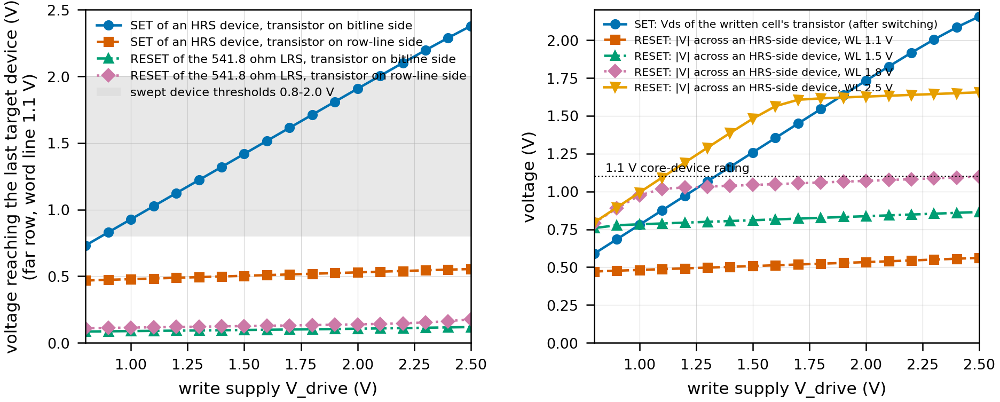
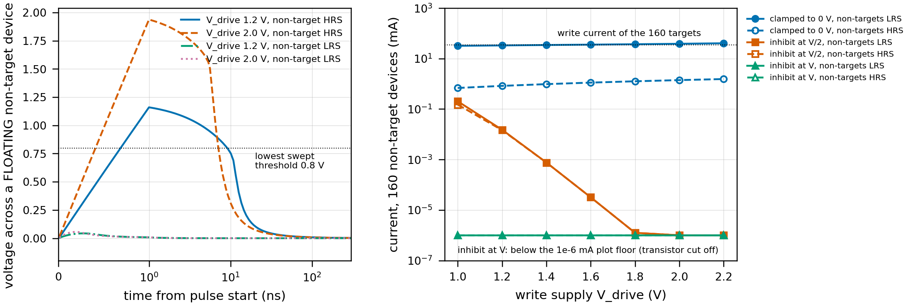
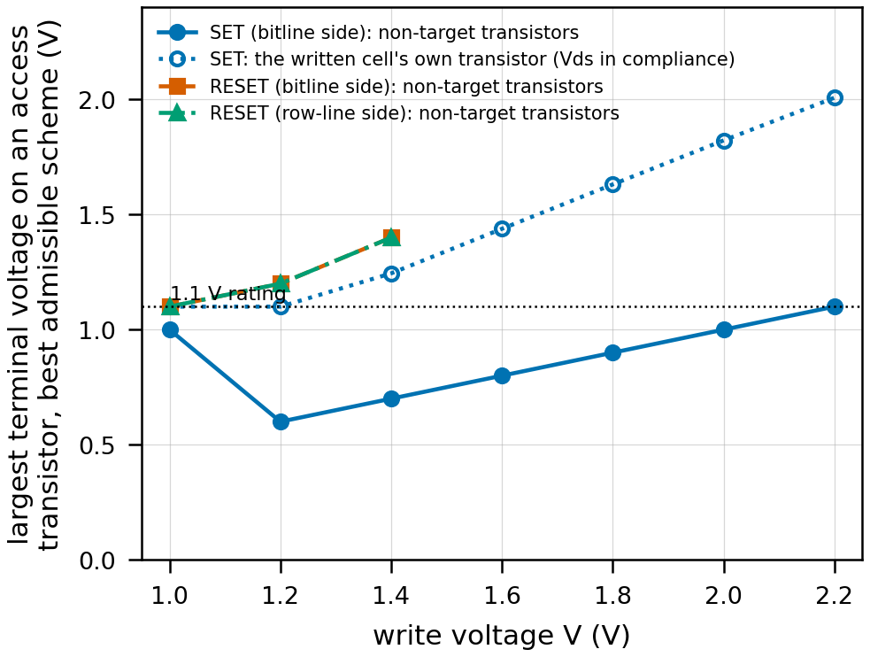

# Phase 1D-i report - the array-level write path

Tags: **[SIM]** ngspice (PTM 45 nm LP BSIM4 access transistors, the full five-macro row), **[MODEL]** analytic in code, **[ASSUM]** assumed, **[CHOICE]** design decision, **[SP]** Stanford-PKU default. Every number below is read from `results/write_path/*.json` by `python -m write.make_report`; commands in section 9.

**The device in this sub-phase is BEHAVIOURAL, not the compact model**: it holds its resistance (1A's 541.82 / 218,586 ohm) until |V| across it has exceeded a threshold for longer than a pulse-width parameter, then moves to the other state (`write/behav.py`). **Every threshold here is a swept parameter (0.8-2.0 V, 10 ns-1 us) and is provisional; 1D-ii replaces them with the compact model's own dynamics.** Carried forward from 1C/1F and not re-derived: 512 x 160 cells in five 32-cell macros, 20 F^2 access transistor (W = 0.54 um, word line 1.1 V), row drivers at both ends of every macro row (10 ohm), rails 0.0072 ohm/pitch fed from both ends, 0.72 ohm/pitch row line and bitline, 0.2 fF/pitch line capacitance.

## 0. The answer

- **Row-parallel SET works on the read-sized array: 160 devices per pulse (one per cell, one row at a time), 33.7 mA peak, and every target reaches its threshold with 0.1-0.2 V of headroom** (worst row and worst column; rails droop 37 mV at the middle row, the row line 77 mV). The rails and drivers are **not** what limits the parallelism; the shared word line and bitlines are (two rows cannot be written at once). Section 1.
- **What limits the write is the 1.1 V core access transistor, in three ways.** (i) **One polarity is source-follower capped at ~0.5 V across the device**: with the transistor on the bitline side a RESET can never put more than 0.12 V across the 541.8 ohm state (and ~0.48-0.56 V across an HRS-side device); with it on the row-line side the same happens to SET. (ii) **RESET of the 541.8 ohm LRS is undeliverable at any swept threshold** in either orientation, even with the word line overdriven to 2.5 V: it needs >= 0.8 V / 541.8 ohm = 1.5 mA, the 20 F^2 transistor gives 0.17-0.33 mA. (iii) **SET above ~1.3 V puts more than 1.1 V across the written cell's own transistor** (Vds 1.07 V at the drive that delivers 1.2 V, 1.45 V for 1.6 V). Section 1.3.
- **The write voltage path cannot share the core read drivers.** Any write above 1.1 V needs thick-oxide (I/O) drivers on every row end and on every bitline, and the read driver's output sits on the same row line, so it must be thick-oxide too: **one thick-oxide driver per row end with a supply mux (0.35 V read / V_write)** at 0.38 mm^2 for the 5,120 row drivers (range 0.19-0.96 [ASSUM]) against 1C's 0.070 mm^2 - the largest area item of the array. Section 1.4.
- **Unselected bitlines: drive them, never float or ground them.** Floating, an HRS neighbour sees up to the full write voltage for 4-9 ns (switches if t_min <= 5 ns, measured with the behavioural device); clamped to 0 V every non-target is written and an LRS row doubles the current. **Recommended: non-target bitlines at V/2 in the SET phase** - the non-target's own access transistor then cuts off (its source sits above V_WL - V_th), so it sees < 0.03 V and carries < 0.2 uA in total, and no access transistor outside the written cell sees more than V/2. Section 2.
- **2T2R half-select: two row-parallel phases (RESET, then SET), the partner addressed by its own bitline.** No cell change is needed for addressing; the partner sees < 0.03 V. Unselected rows: leakage bounds the disturb (0.16-0.27 nA per cell at 125 C, < 0.1 mV across the device). **But the RESET phase has no bias scheme that keeps the 511 x 160 off transistors on a target bitline inside 1.1 V above V_RESET = 1.4 V**: their gate sits at 0 V and their drain on the bitline. Section 3.
- **Full-array program at the measured parallelism: 0.37 ms at 100 ns pulses, 3.1 ms at 1 us** (512 rows x 2 phases x 3 pulses [ASSUM] with a verify after each); energy at 1B's 10 pJ [ASSUM] 4.9 uJ, but the array-level estimate at the measured row current is 6.3 uJ at 100 ns and 63 uJ at 1 us: **10 pJ per pulse is optimistic for any pulse longer than ~30 ns.** Peak write current 34 mA on a 1-2 V write rail (below the read PDN's 69 mA, but a different rail with its own decoupling). Section 4.
- **Reprogramming: the front-end trims and the rank-3 gain correction survive; the ladder survives only if the program-verify places the population mean where it did before.** A full regeneration is 45,218 full-array reads (0.45 ms); the trim re-fit alone is 162 reads (1.6 us) and is the same procedure as 1F's 5 K thermal recalibration. Section 5.
- **Handoff to 1D-ii (section 7): SET can deliver 0.8-2.4 V to an HRS device (bitline-side transistor, 1.1 V word line), at 200-330 uA of per-device current, any pulse width from 10 ns to DC, 160 devices per pulse; within the 1.1 V transistor rating the SET drive is limited to ~1.3 V. RESET can deliver at most ~0.5 V across a high-resistance device and 0.09-0.13 V across a 541.8 ohm one, at 0.17-0.22 mA from the 541.8 ohm state (section 1.3).** Every device number that needs more is flagged as needing a different array.

## 1. D1 - can the read-sized array carry a write

`write/rowdeck.py` builds the selected row of the full array in ngspice: five macros of 64 bitlines, the row line (0.72 ohm per bitline pitch) broken between macros with a write driver at both ends of every macro row, all ten drivers on one tap of the supply rail (0.0072 ohm/row pitch, fed both ends: the tap at the middle row sees 0.92 ohm), every bitline as the selected cell (behavioural device + BSIM4 transistor, word line 1.1 V) then an 8-section RC ladder of bitline (0.72 ohm and 0.2 fF per pitch from the selected row to the edge) then a bitline driver (10 ohm [ASSUM]) returning through the ground rail (0.0072 ohm/column pitch, one pad per macro). Row 512 is the worst case for the bitline (369 ohm of wire in series), row 256 for the supply rail. The written row: the LRS device of each of 160 cells (random weights), the partner held as in section 2. Snapshots (`write/d1_parallel.py`): *before* (all targets still HRS: the threshold check), *last* (all targets switched except the worst-placed one per macro: the voltage left for the last device while its neighbours draw their post-switch current), *after* (all switched: peak current).

### 1.1 Row-parallel SET: delivered voltage, current, droop (transistor on the bitline side, word line 1.1 V)

| V_drive (V) | row | before: min V at a target (V) | last: V at the last target (V) | supply current after (mA) | rail droop (mV) | largest driver current (mA) / drop (mV) | row-line droop (mV) | Vds of a written transistor (V) |
|---|---|---|---|---|---|---|---|---|
| 1.0 | 256 | 0.993 | 0.889 | 36.0 | 33.2 | 3.61 / 36 | 110 | 0.76 |
| 1.0 | 512 | 0.993 | 0.928 | 32.4 | 0.2 | 3.25 / 33 | 69 | 0.78 |
| 1.2 | 256 | 1.191 | 1.084 | 37.4 | 34.6 | 3.76 / 38 | 114 | 0.95 |
| 1.2 | 512 | 1.191 | 1.124 | 33.7 | 0.2 | 3.38 / 34 | 72 | 0.97 |
| 1.4 | 256 | 1.390 | 1.279 | 38.9 | 35.9 | 3.91 / 39 | 118 | 1.14 |
| 1.4 | 512 | 1.390 | 1.320 | 34.9 | 0.3 | 3.51 / 35 | 74 | 1.16 |
| 1.6 | 256 | 1.589 | 1.473 | 40.4 | 37.3 | 4.05 / 41 | 123 | 1.33 |
| 1.6 | 512 | 1.588 | 1.516 | 36.2 | 0.3 | 3.64 / 36 | 77 | 1.35 |
| 2.0 | 256 | 1.986 | 1.862 | 43.8 | 40.4 | 4.39 / 44 | 133 | 1.71 |
| 2.0 | 512 | 1.985 | 1.908 | 39.2 | 0.3 | 3.94 / 39 | 83 | 1.73 |
| 2.4 | 256 | 2.383 | 2.239 | 50.7 | 46.9 | 5.10 / 51 | 154 | 2.07 |
| 2.4 | 512 | 2.382 | 2.290 | 46.9 | 0.3 | 4.71 / 47 | 99 | 2.08 |

- **Delivery (a target that does not reach threshold is not programmed):** the smallest V_drive at which every target, including the last one, sees more than the swept threshold:

| threshold V_th (V) | V_drive needed, row 256 / 512 (V) | voltage at the last target (V) | Vds of the written transistor at that drive (V) | within the 1.1 V rating |
|---|---|---|---|---|
| 0.8 | 1.0 / 0.9 | 0.889 / 0.830 | 0.76 | yes |
| 1.0 | 1.2 / 1.1 | 1.084 / 1.026 | 0.95 | yes |
| 1.2 | 1.4 / 1.3 | 1.279 / 1.222 | 1.14 | **no** |
| 1.4 | 1.6 / 1.5 | 1.473 / 1.418 | 1.33 | **no** |
| 1.6 | 1.8 / 1.7 | 1.668 / 1.614 | 1.52 | **no** |
| 1.8 | 2.0 / 1.9 | 1.862 / 1.810 | 1.71 | **no** |
| 2.0 | 2.2 / 2.1 | 2.053 / 2.005 | 1.90 | **no** |

  The array loses 0.06-0.14 V between the pad and the last device at 10 ohm drivers (rail + driver + row line); 0.1-0.2 V of headroom on the 0.1 V grid of the sweep covers it at every threshold. **Every swept threshold is deliverable for SET; thresholds above ~1.2 V need a drive that puts more than 1.1 V across the written cell's own (core) transistor once it has switched** (the behavioural LRS is 541.8 ohm, so after switching the transistor carries the write current in saturation and holds the rest of the drive).
- **The far columns** (1C found starvation at read voltages): with both-end drivers the worst row-line position is the middle of each macro; its loss at the full 160-cell write is 77 mV at 1.6 V - small against the threshold, and every column was switched in the transient (1.4).
### 1.2 The rails and the drivers at write current

| V_drive (V) | row | R_WDRV (ohm) | rail (ohm/pitch) | supply (mA) | rail droop (mV) | driver drop (mV) | loss pad -> last target (mV) |
|---|---|---|---|---|---|---|---|
| 1.6 | 256 | 5 | 0.0072 | 40.5 | 37.4 | 20 | 107 |
| 1.6 | 512 | 5 | 0.0072 | 36.3 | 0.3 | 18 | 66 |
| 1.6 | 256 | 5 | 0.072 | 38.2 | 352.6 | 19 | 409 |
| 1.6 | 512 | 5 | 0.072 | 36.3 | 2.6 | 18 | 69 |
| 1.6 | 256 | 10 | 0.0072 | 40.4 | 37.3 | 41 | 127 |
| 1.6 | 512 | 10 | 0.0072 | 36.2 | 0.3 | 36 | 84 |
| 1.6 | 256 | 10 | 0.072 | 38.1 | 351.4 | 38 | 426 |
| 1.6 | 512 | 10 | 0.072 | 36.2 | 2.6 | 36 | 86 |
| 1.6 | 256 | 20 | 0.0072 | 40.1 | 37.0 | 80 | 164 |
| 1.6 | 512 | 20 | 0.0072 | 36.0 | 0.3 | 72 | 118 |
| 1.6 | 256 | 20 | 0.072 | 37.8 | 349.0 | 76 | 460 |
| 1.6 | 512 | 20 | 0.072 | 36.0 | 2.6 | 72 | 120 |
| 1.6 | 256 | 50 | 0.0072 | 39.2 | 36.2 | 196 | 275 |
| 1.6 | 512 | 50 | 0.0072 | 35.3 | 0.3 | 177 | 218 |
| 1.6 | 256 | 50 | 0.072 | 37.0 | 342.0 | 186 | 558 |
| 1.6 | 512 | 50 | 0.072 | 35.3 | 2.5 | 177 | 220 |

- **The 0.0072 ohm/pitch rails sized for the 69 mA read hold the write** (34-46 mA): 33-43 mV at the middle row. **At 0.072 ohm/pitch they do not** (0.33-0.38 V lost at the middle row - more than the headroom). Drivers: 10-20 ohm keeps the loss to 0.08-0.16 V; 50 ohm loses 0.2-0.3 V. **A write driver of <= 20 ohm per row end is the requirement**, the same class as 1C's read driver.
### 1.3 What the access transistor allows - both polarities, both orientations, word line 1.1-2.5 V

Delivered |V| across the target at its starting state (SET: HRS, RESET: the 541.8 ohm LRS), best over V_drive <= 2.5 V, row 512:

| word line (V) | SET, transistor on bitline side | SET, transistor on row-line side | RESET, bitline side | RESET, row-line side |
|---|---|---|---|---|
| 1.1 (rated) | 2.38 V | 0.55 V | 0.12 V | 0.18 V |
| 1.5 (overstress) | 2.34 V | 0.86 V | 0.20 V | 0.26 V |
| 1.8 (overstress) | 2.30 V | 1.09 V | 0.25 V | 0.33 V |
| 2.5 (overstress) | 2.20 V | 1.64 V | 0.39 V | 0.50 V |

- **The source follower.** An NMOS whose source is the node next to the device cannot pull that node above V_WL - V_th (~0.5 V at 1.1 V, falling with body effect). With the transistor on the bitline side that node is the device's low side in RESET; on the row-line side it is the device's high side in SET. **So at a 1.1 V word line one polarity is capped at ~0.5 V whatever the drive.** [CHOICE] **bitline side** - the orientation in which SET (which needs current: the LRS is reached under transistor compliance) gets the full voltage; RESET is the capped polarity. 1A-1C simulated the read with the transistor on the row-line side; the read is unaffected to first order (in both orientations the transistor's source sits at the 0.25 V sense node in 1F's read: see the 1D-ii report's R_tx check).
- **RESET of the 541.8 ohm state is not deliverable, in either orientation, at any word line up to 2.5 V**: the device current needed for a threshold of 0.8 V is 1.5 mA, and the transistor delivers 0.17-0.22 mA (bitline side) / 0.22-0.33 mA (row-line side) at 1.1 V and at most 0.7-0.9 mA at 2.5 V. With the behavioural model this means: **the 1A LRS cannot be RESET by the 20 F^2 cell.** This is a property of the read-optimised operating point (a 541.8 ohm state behind a minimum-size transistor), not of any threshold value, and it is the first thing 1D-ii has to test with the compact model.
### 1.4 The write voltage path: shared or separate drivers, and the area

Write voltages above 1.1 V cannot pass through or sit on a core device. The read drivers (1C: 5,120 core devices, W = 54.9 um each at 10 ohm, 0.070 mm^2) drive the same row lines; during a write their outputs see V_write. Options [area: thick-oxide R x W = 1000 / 1500 / 2500 ohm um and 1.5 / 2 / 3x the core area per um, ASSUM; core 548.7 ohm um, 1A]:

| option | what is thick-oxide | row-driver area (mm^2), low / mid / high | verdict |
|---|---|---|---|
| A. one driver per row end, thick-oxide, supply mux 0.35 V / V_write | 5,120 drivers sized for the READ (10 ohm) | 0.19 / 0.38 / 0.96 | **recommended**: one device, sized by the read |
| B. separate thick-oxide write drivers (20 ohm) + core read drivers behind a thick-oxide isolation switch (2 ohm) | 5,120 write drivers + 5,120 switches | 1.13 / 2.18 / 5.35 | the switch in the read path must be ~5x below R_DRV: larger than A |
| C. keep everything core, V_write <= 1.1 V | none | 0.070 (1C) | only for device thresholds below ~0.9 V; RESET still capped (1.3) |

Bitlines need the same: a three-level write driver per bitline (0, V/2, V; it sinks <= 0.33 mA, a 100 ohm device is enough) and a thick-oxide isolation switch between the bitline and the 1F sense front-end (core devices at a 0.25 V virtual ground), 320 of each: ~0.01-0.03 mm^2 [ASSUM]. **The write path costs 0.15-0.96 mm^2 of thick-oxide drivers - comparable to or larger than 1F's whole 0.43 mm^2.** 1C's row-driver total (already 50% of the array) multiplies by 2.2-13x.
### 1.5 The largest viable parallelism

| cells written per pulse (spread over the five macros) | V_drive 1.6 V: V at the last target (V) | supply (mA) | largest driver current (mA) | row-line droop (mV) |
|---|---|---|---|---|
| 1 | 1.591 | 0.2 | 0.12 | 4 |
| 5 | 1.591 | 1.1 | 0.12 | 4 |
| 10 | 1.587 | 2.3 | 0.23 | 7 |
| 20 | 1.580 | 4.6 | 0.46 | 14 |
| 40 | 1.567 | 9.1 | 0.92 | 27 |
| 80 | 1.545 | 18.2 | 1.83 | 49 |
| 120 | 1.528 | 27.2 | 2.73 | 66 |
| 160 | 1.516 | 36.2 | 3.64 | 77 |

**Largest viable parallelism: 160 devices per pulse = one whole row (one device per cell), limited by the array structure, not by the rails or drivers.** All 320 devices of a row share one word line, so the two devices of a cell cannot be written in the same pulse in opposite directions (section 3), and two rows on the same bitlines cannot be written at once. The rails would carry several rows (a second row adds ~35 mA and ~35 mV at the middle tap) if the word lines were segmented per macro - not part of 1C's array [CHOICE: not adopted].
### 1.6 The write as a transient (behavioural device in all 320 positions)

| case | targets switched | non-targets switched | switch time of the targets (ns) | peak supply current (mA) |
|---|---|---|---|---|
| V_drive 1.2 V, V_th 1.0 V, t_min 100 ns, non-targets at 0.6 V | 160/160 | 0 | 105.1-105.6 | 33.7 |
| V_drive 1.3 V, V_th 1.2 V, t_min 100 ns, non-targets at 0.65 V | 160/160 | 0 | 112.0-113.6 | 34.3 |
| V_drive 1.2 V, V_th 0.8 V, t_min 5 ns, non-targets float | 160/160 | 160 | 7.3-7.3 | 33.7 |
| V_drive 1.2 V, V_th 0.8 V, t_min 10 ns, non-targets float | 160/160 | 0 | 12.2-12.2 | 33.7 |
| V_drive 2.0 V, V_th 0.8 V, t_min 10 ns, non-targets float | 160/160 | 0 | 12.0-12.0 | 39.3 |



*Figure 22.* Left: the voltage that reaches the last target device of a row-parallel write (far row, word line 1.1 V) against the write supply, for SET of an HRS device and RESET of the 541.8 ohm LRS, with the access transistor on either side; grey: the swept device thresholds. Only SET with the transistor on the bitline side reaches the band. Right: the Vds of the written cell's own transistor after it has switched (SET) and the source-follower cap on RESET for word lines 1.1-2.5 V; dotted: the 1.1 V rating.

## 2. D2 - the unselected (non-target) bitlines

In a row-parallel write every cell has one target and one non-target device (its partner); in a partial row whole cells are non-targets. `write/d2_unselected.py`.

**(a) Floating.** The bitline (102 fF) charges toward the row line through the non-target device and its access transistor, which is ON (the word line is shared). Measured (transient, device held at its state, far row):

| V_drive (V) | non-target state | peak V across it (V) | time above 0.8 V (ns) | time above 1.0 V (ns) | time above 1.2 V (ns) |
|---|---|---|---|---|---|
| 1.0 | LRS | 0.039 | 0.00 | 0.00 | 0.00 |
| 1.0 | HRS | 0.966 | 4.35 | 0.00 | 0.00 |
| 1.2 | LRS | 0.043 | 0.00 | 0.00 | 0.00 |
| 1.2 | HRS | 1.160 | 8.55 | 3.60 | 0.00 |
| 1.4 | LRS | 0.047 | 0.00 | 0.00 | 0.00 |
| 1.4 | HRS | 1.354 | 8.55 | 6.80 | 2.85 |
| 1.6 | LRS | 0.050 | 0.00 | 0.00 | 0.00 |
| 1.6 | HRS | 1.549 | 7.80 | 7.05 | 5.80 |
| 1.8 | LRS | 0.053 | 0.00 | 0.00 | 0.00 |
| 1.8 | HRS | 1.743 | 7.05 | 6.30 | 6.05 |
| 2.0 | LRS | 0.056 | 0.00 | 0.00 | 0.00 |
| 2.0 | HRS | 1.938 | 6.77 | 6.02 | 5.52 |
| 2.2 | LRS | 0.059 | 0.00 | 0.00 | 0.00 |
| 2.2 | HRS | 2.132 | 6.44 | 5.69 | 5.19 |

- **It depends on what the neighbour stores** (as 1C found at read voltages): an LRS neighbour charges its bitline in ~0.2 ns and never sees more than 0.06 V; an HRS neighbour sees nearly the full drive for 4-9 ns (the bitline only has to reach V_WL - V_th ~ 0.5 V for its transistor to cut off, after which the internal node follows the row line). **Disturb if t_min < ~5-9 ns** - confirmed with the behavioural device in all 320 positions: at t_min = 5 ns all 160 HRS neighbours switched, at 10 ns none (section 1.6). With the compact model there is no threshold, only a rate: 1D-ii quantifies the gap an HRS neighbour loses in these few nanoseconds.

**(b) Clamped.** DC, far row, non-targets held at 0 V / at V/2 / at the row level V:

| V_drive (V) | non-targets | clamp to 0 V: max V across (V), current (mA) | inhibit V/2: max V (V), current (mA) | inhibit V: max V (V), current (mA) |
|---|---|---|---|---|
| 1.0 | LRS | 0.110, 31.93 | 0.0007, 0.2027 | 0.0000, 0.00000 |
| 1.0 | HRS | 0.961, 0.69 | 0.2101, 0.1496 | 0.0000, 0.00000 |
| 1.2 | LRS | 0.114, 33.19 | 0.0001, 0.0152 | 0.0000, 0.00000 |
| 1.2 | HRS | 1.159, 0.83 | 0.0209, 0.0147 | 0.0000, 0.00000 |
| 1.6 | LRS | 0.123, 35.69 | 0.0000, 0.0000 | 0.0000, 0.00000 |
| 1.6 | HRS | 1.553, 1.12 | 0.0000, 0.0000 | 0.0000, 0.00000 |
| 2.0 | LRS | 0.133, 38.53 | 0.0000, 0.0000 | 0.0000, 0.00000 |
| 2.0 | HRS | 1.948, 1.40 | 0.0000, 0.0000 | 0.0000, 0.00000 |

- **Clamped to 0 V** every non-target sees the full write: it is being written, not protected; with LRS non-targets the row draws twice the current (the clamp current equals the target current: 32-41 mA more on the rails of section 1.2). Rejected.
- **Inhibit at V or V/2**: the non-target's own access transistor has its source on the bitline; once the bitline is above V_WL - V_th (~0.5 V) the transistor is off and the device sees essentially nothing (the internal node floats to the row level). At V/2 below ~1.4 V the transistor is still partly on: up to 0.2 V and 0.2 mA total at 1.0 V, 0.02 V at 1.2 V.
- **(c) Recommendation: drive the non-target bitlines to V/2 in the SET phase (to the row level, 0 V, in the RESET phase).** Disturb < 0.03 V and < 0.2 mA extra at V >= 1.2 V. V/2 rather than V because of the access transistors on the UNSELECTED rows (section 3): with the bitline at V their gate (0 V) to drain voltage is V; at V/2 it is V/2. Floating is acceptable only if the device's minimum switching time is > ~10 ns (an assumption 1D-ii must check).



*Figure 23.* Left: voltage across a floating non-target device during a row-parallel SET (far row): an HRS neighbour holds most of the write voltage for several ns, an LRS neighbour almost none. Right: the DC current through the 160 non-target devices when their bitlines are clamped to 0 V, held at V/2 or at the row level.

## 3. D3 - half-select inside the 2T2R cell and on the unselected rows

**(a) Addressing.** Both devices of a cell share the word line and the row line but sit on different bitlines, so **separate bitline drive is enough** - no cell change. A cell's two devices go in opposite directions, so a row is written in **two row-parallel phases: RESET (the devices that must become HRS) then SET (the devices that must become LRS)** [CHOICE: RESET first, so that during the SET phase every partner is HRS and its transistor cuts off at V/2; an LRS partner at V/2 and 1.2 V draws 17 uA per row through the partly-on transistor].

**(b)/(c) Every device class during one phase** (`write/d3_halfselect.py`: device + BSIM4 transistor between ideal line levels; non-target bitline, unselected row line and unselected word line each swept over 0 / V/2 / V; device LRS and HRS; 27 and 125 C). Admissible = no non-target device sees more than 0.4 V (half the lowest swept threshold) [CHOICE] and the unselected array draws < 100 uA; among those, the scheme with the smallest stress on the transistors other than the written one:

| phase | V (V) | non-target BL | unselected RL | unselected WL | |V| on the target (V) | worst non-target |V| (V) | written transistor stress (V) | other transistors' stress (V) | unselected-array leakage 27 / 125 C (uA) |
|---|---|---|---|---|---|---|---|---|---|
| SET | 1.0 | V | V/2 | 0 | 0.996 | 0.000 | 1.10 | 1.00 | 0.39 / 11.3 |
| SET | 1.2 | V/2 | 0 | 0 | 1.195 | 0.022 | 1.10 | 0.60 | 0.47 / 12.9 |
| SET | 1.4 | V/2 | 0 | 0 | 1.394 | 0.001 | 1.24 | 0.70 | 0.56 / 14.7 |
| SET | 1.6 | V/2 | 0 | 0 | 1.594 | 0.000 | 1.44 | 0.80 | 0.67 / 16.8 |
| SET | 2.0 | V/2 | 0 | 0 | 1.992 | 0.000 | 1.82 | 1.00 | 0.96 / 22.0 |
| SET | 2.2 | V/2 | V/2 | 0 | 2.191 | 0.000 | 2.01 | 1.10 | 1.15 / 25.3 |
| RESET | 1.0 | 0 | V/2 | 0 | 0.104 | 0.000 | 1.00 | 1.10 | 0.39 / 11.3 |
| RESET | 1.2 | 0 | V/2 | 0 | 0.108 | 0.000 | 1.09 | 1.20 | 0.47 / 12.9 |
| RESET | 1.4 | 0 | V/2 | 0 | 0.112 | 0.000 | 1.29 | 1.40 | 6.64 / 20.8 |
| RESET | 1.6 | - | - | - | - | - | - | **no admissible scheme** | - |
| RESET | 2.0 | - | - | - | - | - | - | **no admissible scheme** | - |
| RESET | 2.2 | - | - | - | - | - | - | **no admissible scheme** | - |

- **The partner during its partner's SET** (S-N, V/2 on its bitline, 1.6 V): 0.05 mV across it at 27 C, 0.53 mV at 125 C, against the RESET (and SET) thresholds of 0.8-2.0 V: a margin of > 0.79 V. Section 2's transient adds no switching skew (the inhibit is driven by the same pulse shape).
- **Unselected rows**: per off cell at the write bias the leakage is 8.2 pA at 27 C and 206 pA at 125 C (1A: 4.6 pA at the read bias, 27 C); the voltage it puts across the device is 42 uV at 125 C. **Leakage bounds half-select on unselected rows at the write voltage and at 125 C, by > 4 orders of magnitude.** (The total, 81,760 off cells, is 1-25 uA - a small DC load on the write supply.)
- **What it does to the core transistors.** SET: with V/2 on the non-target bitlines no transistor outside the written cell sees more than V/2 - inside 1.1 V up to V = 2.2 V; **the written cell's own transistor holds V - V_device in compliance: above 1.1 V for V >= ~1.3 V.** RESET: a target bitline at V faces 511 off transistors whose gate is at 0 V, so their gate-drain voltage is V; raising the unselected word lines turns them on (amperes through 81,760 cells). **No admissible RESET scheme keeps the array inside 1.1 V above V_RESET = 1.1 V, and none is admissible at all above 1.4 V** (gate-induced drain leakage then exceeds the load limit). Together with 1.3: **a RESET above ~1.1 V needs thick-oxide access transistors - a different array.**



*Figure 24.* The largest terminal voltage on any access transistor for the best admissible bias scheme, against the write voltage: SET (transistor on the bitline side) keeps every other transistor at V/2, but the written transistor itself exceeds 1.1 V from ~1.3 V; RESET has no admissible scheme above 1.4 V and exceeds the rating from 1.1 V.

## 4. D4 - program time, energy, sequencing

Parallelism 160 devices per pulse (section 1.5), two phases per row, 512 rows, **3 pulses per device and 10 pJ per pulse are 1B's [ASSUM] until 1D-ii**, a verify read (1F's 10 ns read cycle) after each pulse, write <-> verify switch-over 2 x 5 ns [ASSUM], pulse edges 1 ns. 1B's placeholder: 4.9 uJ, 0.31 ms at 100 ns (row-parallel, no verify).

| pulse width | full-array program time (ms) | energy at 10 pJ/pulse [ASSUM] (uJ) | array energy at the measured row current (uJ) [MODEL] | verify reads (uJ) | without verify: time (ms) |
|---|---|---|---|---|---|
| 10 ns | 0.098 | 4.92 | 0.63 | 0.70 | 0.037 |
| 30 ns | 0.160 | 4.92 | 1.90 | 0.70 | 0.098 |
| 100 ns | 0.375 | 4.92 | 6.32 | 0.70 | 0.313 |
| 300 ns | 0.989 | 4.92 | 18.96 | 0.70 | 0.928 |
| 1000 ns | 3.140 | 4.92 | 63.19 | 0.70 | 3.078 |

- The array-level estimate uses the measured row current (34.3 mA at 1.2 V: the behavioural LRS at the transistor's compliance) for half the pulse on average [MODEL]: **at pulses longer than ~30 ns the post-switch current, not the switching event, dominates the energy**, and 10 pJ per pulse is optimistic by 1-2 orders at 1 us. 1D-ii replaces both the pulse count and the energy with the compact model's.
- **Peak write current: 34 mA** (34-46 mA over V_drive 1.0-2.2 V, section 1.1) against the read PDN's 69 mA: lower, but **on a separate 1-2 V write rail**; 1F section 5's decoupling sits on the 0.35 V read rail and does not serve it. The write rail needs its own regulator and decoupling: a 40 mA step with a ~16 MHz regulator loop (1F's assumption) and 50 mV of droop needs ~8 nF [MODEL: I / (2 pi f_reg) / dV] - unless the pulse edges are slowed to the regulator's bandwidth (a 1 us pulse with 100 ns edges needs much less).

**(b) The write sequence - a requirement for the RTL (not implemented):**

```
for each row r = 0..511 (any order; rows are independent):
  phase R (RESET): selected row line 0 V; word line r at V_WL; bitlines of the devices that must be HRS driven to V_RESET; all other bitlines at 0 V (= row level);
                   unselected row lines 0 / V/2, unselected word lines 0 V; apply pulse; switch to verify; read row r (160 columns, 1F read path);
                   retire the devices that verified; repeat with the 1D-ii amplitude/width schedule until all retired or N_max
  phase S (SET):   selected row line V_SET; bitlines of the devices that must be LRS at 0 V; non-target bitlines at V_SET/2; unselected row lines 0 V,
                   unselected word lines 0 V; pulse; verify; retire; repeat
state the controller holds: the 160-bit weight row (gives both target masks: + device of a 1-cell / - device of a 0-cell), a 320-bit retired mask, the phase,
  the iteration count (<= N_max, 1D-ii), the current pulse amplitude/width code (per row, or per device if the 1D-ii schedule is per device: 320 x a few bits),
  the bias-level selects of the five line classes, and the mode (write / verify) with its switch-over timing
the a = 0 skip and group sequencing of the read path are not involved; programming is row-sequential
```

## 5. D5 - what reprogramming costs the rest of the design

| stored state | depends on | survives a reprogram? | regeneration |
|---|---|---|---|
| per-group ladder thresholds (1C, 16,140 bits half table) | geometry + the POPULATION MEAN of the programmed LRS/HRS conductances (not individual cells) | yes if the verify targets and their mean placement are unchanged; no if the targets or the program-verify bias move | measure the level of every (group, a, m) on reference patterns: 64 groups x 44 levels x 16 reads = 45,056 full-array reads |
| rank-3 row-gain correction (1C, 19,584 bits) | geometry (row line, rails) and the active-row count a; weights only through the data-dependent terms already in the budget | yes | not needed; re-fit only if the rails/drivers change |
| per-column front-end trims (1F, 2 x 2 x 10 bits per column = 6.4 kbit) | the sense front-end's own mismatch and temperature; NOT the cells | yes (front-end property) - but it is FITTED through known cells, so it can only be re-fitted once the array holds known data | 18 known configurations (2 groups x m = 0..8) x 9 reads = 162 full-array reads per fit |
| 1F thermal recalibration (every ~5 K) | front-end gain/offset drift 0.05 uA/K (1F) [+ the cell read-current TC if any: 1D-ii D3] | n/a | the same 162-read trim fit |

- **The split the brief expected holds, with one qualification.** 1F's front-end trims are a property of the front-end, not of the cells - but they are FITTED through known cells, so they can only be re-fitted once the array holds known data (after the program, never during it). 1C's thresholds depend on the cells, but only through the population mean of the programmed conductances (the geometry and the target states set them; the individual cell's spread is the budget's sigma term): if the program-verify window is centred where it was, the table survives.
- **Cost:** trims only: 162 full-array reads = 1.6 us and 37 nJ (1F's 228 pJ per read); a full ladder regeneration: 45,056 reads = 0.45 ms and 10.3 uJ, plus a per-column two-parameter least-squares fit on 18 points (~100 multiply-adds per column, 16k for the array) on the digital side. Both are small against the program itself.
- **(c) Post-program calibration and the 5 K thermal recalibration are the same procedure for the trims** (18 known configurations x 9 reads, re-fit 2 x 2 parameters per column). The post-program calibration adds a check of the ladder's level scale (a few reference reads per group; full regeneration only if it moved). Whether the thermal recalibration must ALSO touch the ladder depends on the cell's read-current temperature coefficient - the compact model has none in the device, but the access transistor does: 1D-ii D3 measures it.

## 6. Every device parameter of this sub-phase is swept and provisional

| parameter | values | status |
|---|---|---|
| SET threshold V_th | 0.8-2.0 V (0.1 V steps) | [ASSUM, swept]: replaced by the compact model's rate equation in 1D-ii (there is no threshold, only a rate) |
| RESET threshold | 0.8-2.0 V | [ASSUM, swept]: as above |
| minimum switching time t_min | 5 ns-1 us (transients 5, 10, 100 ns) | [ASSUM, swept]: replaced in 1D-ii |
| switching time constant after firing | 2 ns | [CHOICE] numerical; latched once fired |
| LRS / HRS during the write | 541.82 / 218,586 ohm, linear | [SIM 1A] at the read bias; the compact model is strongly non-linear at write voltages (1D-ii) |
| pulses per device, energy per pulse | 3, 10 pJ | [ASSUM, 1B]: replaced by 1D-ii D2 |

## 7. Handoff to 1D-ii - what the array can deliver

| quantity | value | status |
|---|---|---|
| cell orientation | access transistor on the BITLINE side | [CHOICE], section 1.3 |
| SET: voltage across an HRS device | V_drive - 0.06..0.14 V, for V_drive 0.8-2.5 V | [SIM] |
| SET: per-device current | 0.20-0.33 mA (transistor compliance at word line 1.1 V; set by the transistor, not the drive) | [SIM] |
| SET: within the 1.1 V transistor rating | V_drive <= ~1.3 V for a 541.8 ohm post-switch state (Vds = V - V_device: a more resistive post-SET state allows more) | [SIM]; 1D-ii re-checks with the real state |
| RESET: voltage across the device | <= ~0.48-0.56 V for a high-resistance device (source follower), 0.09-0.13 V for the 541.8 ohm state | [SIM] |
| RESET: per-device current | 0.17-0.22 mA from the 541.8 ohm state | [SIM] |
| RESET above 1.1 V on the bitline | outside the rating of the 511 off transistors per column | [SIM] section 3 |
| pulse width | 10 ns (1 ns edges; the array's own RC is < 0.1 ns) to DC: the array holds a level indefinitely, the cost is time | [SIM] |
| parallelism | 160 devices per pulse (one row, one device per cell, per phase) | [SIM] |
| series resistance in the write path | row side ~17 ohm (drivers + half a macro row + rail); bitline side 11 ohm (row 1) to 379 ohm (row 512) | [MODEL] |
| unselected bitlines | V/2 (SET phase), 0 V (RESET phase); floating disturbs an HRS neighbour for 4-9 ns | [SIM] |
| a different array | anything that needs > 0.33 mA per device, > ~0.5 V across the device in RESET, or > 1.1 V on a bitline in RESET | flag |

**Handoff to the RTL:** the write sequence of section 4(b) as a specification: row-sequential, two phases, a 160-bit weight row giving both target masks, a 320-bit retired mask, three bias levels on the bitlines (0, V/2, V), the write/verify mode switch.

## 8. TO BE DETERMINED (updated list)

- **The device's switching thresholds, minimum switching time, forming** - 1D-ii (compact model).
- **Thick-oxide device data** (on-resistance x width, area per width, oxide rating): no card in PTM; the write-driver area (0.15-0.96 mm^2) rests on [ASSUM] values.
- **Write-rail regulator and decoupling** (a separate 1-2 V rail; ~8 nF for a fast 40 mA step [MODEL]).
- **Hot-carrier / oxide reliability of the 1.1 V access transistor at Vds 1.1-1.8 V during a SET** - the SET points above ~1.3 V are flagged as outside the rating, not as failing.
- Carried from 1C/1F: sigma_lnG (1D-ii), drift (1D-ii), wire / rail / driver resistance [ASSUM], comparator latch noise, threshold generator, the calibration procedure (now specified in section 5 as reads; the reference data are the freshly programmed weights).

## 9. Files and reproduction

```
python -m write.d1_parallel      # D1: delivery, droop, drivers, rails, parallelism, both polarities/orientations/word lines (~30 s on 24 cores)
python -m write.d1_transient     # D1/D2: the row-parallel write with the behavioural device in all 320 positions
python -m write.d2_unselected    # D2: floating / clamped / inhibited non-target bitlines
python -m write.d3_halfselect    # D3: device classes x bias schemes, 27 and 125 C
python -m write.d4_d5            # D4/D5: program time, energy, sequence, recalibration
python -m write.figures          # figures 22-24
python -m write.make_report      # this file
```
`write/rowdeck.py` (the row deck), `write/behav.py` (the behavioural device), `write/run.py` (DC / transient helpers). ngspice >= 38 is resolved by `spice/osdi.py` (PATH or nix).
