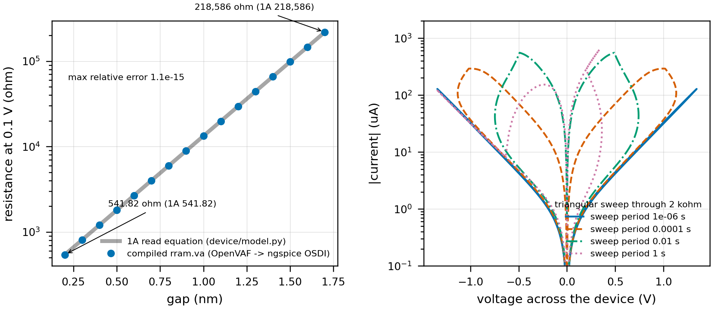
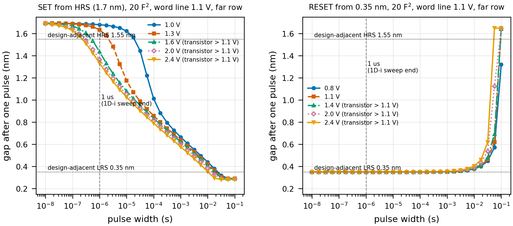
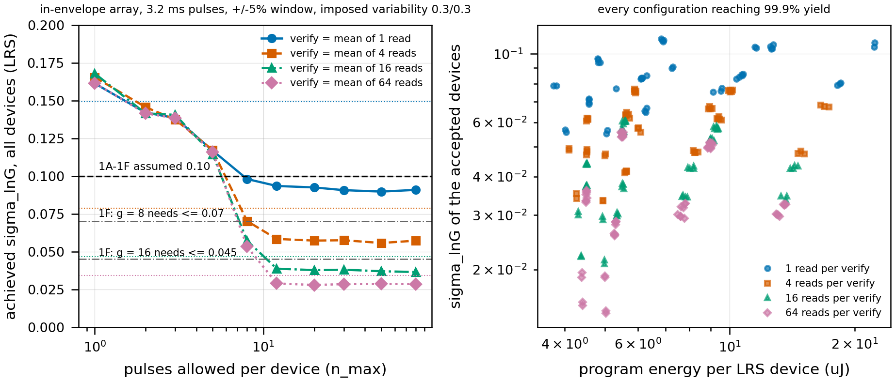
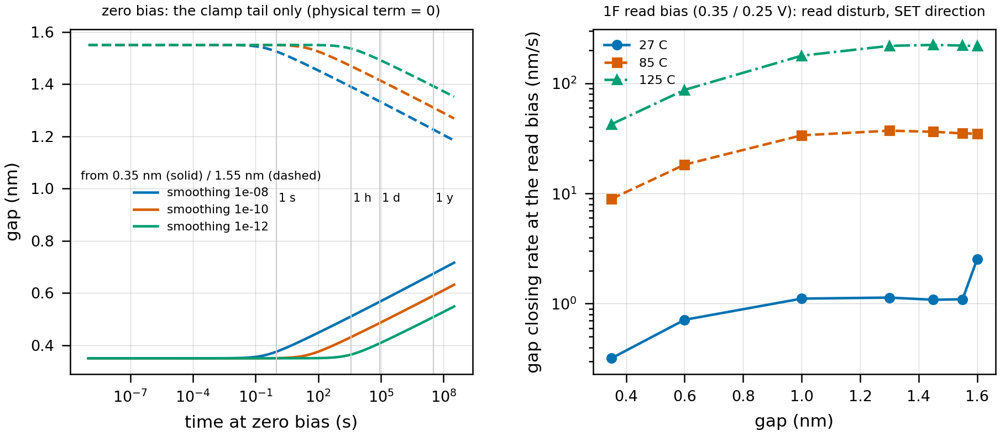
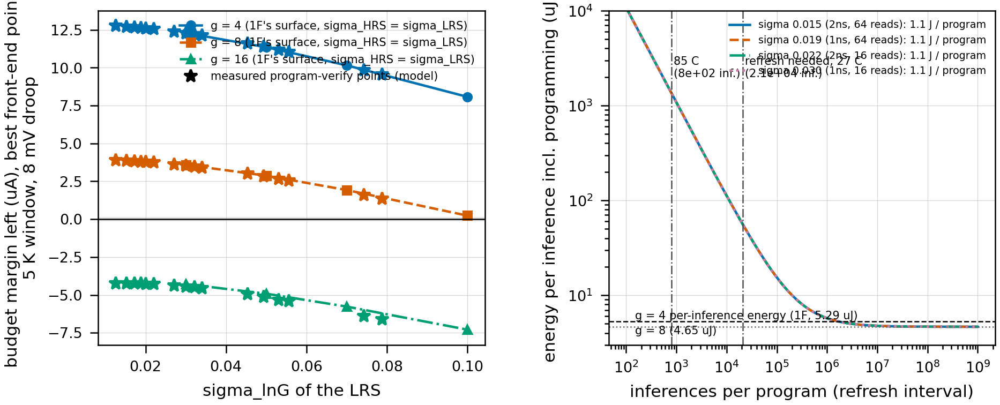

# Phase 1D-ii report - the device-level write path, with the compiled compact model

Tags: **[SIM]** ngspice with the COMPILED `rram.va` (OpenVAF -> OSDI) and the PTM 45 nm LP BSIM4 access transistor, **[MODEL]** analytic / Python in code, **[ASSUM]** assumed, **[CHOICE]** design decision, **[SP]** Stanford-PKU default. Every number below is read from `results/compact_model/` and `results/program_verify/` by `python -m program.make_report`; commands in section 10.

> **sigma_lnG here is a MODEL result, not silicon.** It comes from a compact model calibrated to someone else's devices (the Stanford-PKU HfOx model in the Wang-Roychowdhury well-posed form), driven through 1D-i's array and 1F's read path. It is far better grounded than the assumed 0.10 of 1A-1F - the loop, the pulse response, the verify read and its noise are simulated - and it is still not a measurement of a fabricated array. Two parts of it are not the model's at all: the model is **deterministic** (no cycle-to-cycle or device-to-device term), so the switching variability that a real array has is IMPOSED [ASSUM, swept 0-0.3]; and the 1A design states sit on the model's numerical clamps, so the placement is measured at the nearest states the model can hold (0.35 / 1.55 nm). Every claim below that rests on sigma_lnG carries both caveats.

Read first and carried forward: 1D-i's write envelope (`phase1d_i_report.md` section 7: access transistor on the bitline side, 20 F^2, word line 1.1 V, SET drive inside the 1.1 V transistor rating up to ~1.3 V, RESET capped at ~0.5 V across a high-resistance device, any pulse width to DC, 160 devices per pulse), 1B's spread model (log-normal on the conductance prefactor, sigma_lnG = sigma_gap / g0) and 1F's closure map (section 8 of its report).

## 0. The answer

- **The rram.va bug is a declaration, not an expression, and 1A's rename is the right fix** - shown, not assumed: the model as received fails to compile (`clip_minGap` undeclared); the fix compiles and holds the gap at minGap under a hard SET (0.2003 nm); the alternative reading 'clip_0 = a clamp at gap 0' compiles too but lets the gap collapse to 0.0007 nm and leaves the minGap parameter dead. Section 1.
- **The compiled model reproduces 1A exactly: R(0.2 nm) = 541.8207 ohm, R(1.7 nm) = 218,586.00 ohm** (1A: 541.82 / 218,586.0 as printed - the 1e-06 difference is 1A's rounding); the read I-V over 0.2-1.7 nm and +/-0.5 V matches 1A's equation to 1e-15. No stop. Section 2.
- **The 20 F^2 array cannot program 1A's design states, and 1A's states are not programmable targets in this model at all.** Forming: absent from the model. SET inside the envelope (<= 1 us, <= 1.3 V) moves an HRS device only to 1.64 nm (169 kohm); the transistor-limited (compliance) SET reaches the design-adjacent 0.35 nm only with ~20-30 ms pulses. RESET is capped at ~0.5 V across the device (1D-i) and does nothing below ~1 ms; 0.35 -> 1.55 nm takes ~0.1 s. 0.2 and 1.7 nm are the model's clamps (a target there measures the clamp). **Doing the design-adjacent states in <= 1 us needs a 100-200 F^2 thick-oxide transistor at a 3 V word line in a near row - in the far row no width up to 400 F^2 does it: a different array.** SET and RESET are both **gradual**, so a verify loop converges. Section 3.
- **sigma_lnG as a function of program effort (in-envelope array, design-adjacent LRS, imposed variability 0.3/0.3):** it falls from 0.16 (one pulse, no verify) to a floor set by the **verify read's own noise**: 0.079 with 1F's single read (T = 1 ns), 0.030 averaging 16 reads, ~0.01-0.03 averaging 64. The floor is reached after 8-12 pulses; more pulses buy nothing (section 4.4). The access transistor at the real read bias (~2 kohm, section 6) divides the device's conductance change by 3.5 before the read sees it - that ballast, good for the inference read, is what makes the verify noisy. HRS: a one-sided verify (G below a ceiling) in 2-10 pulses, sigma 0.2-0.5, which costs < 0.1 uA in the budget. Section 4.
- **What it costs (in-envelope): ~1.1 J and ~114 s for the full 163,840-device array** at the 16-read point (160 devices per pulse, millisecond pulses: SET 1-30 ms, RESET 10-100 ms). 1B's placeholder was 4.9 uJ; 1D-i's estimate at 1 us pulses 63 uJ. The design-capable (out-of-envelope) array would do it in ~0.0034 s and 1.6 mJ. Section 4.5.
- **Drift: the model has NO retention mechanism, and an artefact that looks like one.** At zero bias the physical gap velocity is exactly zero at any temperature; the only motion is the clamp tail, which relaxes 0.35 -> 0.57 nm in a day and 1.55 -> 1.33 nm and scales with the `smoothing` parameter - numerical, not physics. **What the model does have is READ DISTURB**: 1F's read puts ~0.1 V across every active device in the SET direction; the gap closes at 0.3-1.1 nm/s at 27 C, 9-37 nm/s at 85 C. With 1E's read pattern the far group's top level moves the 0.27 uA that 1B/1C allotted to drift after **20,990 inferences at 27 C, 796 at 85 C** (g = 8). The 'moderate' drift term was optimistic in kind: the device drifts per read, not per hour. Section 5.
- **Temperature: the device's read current has no temperature term (ABSENT); the read path's does, through the access transistor:** the far group's top level moves 0.52 uA/K and the near group's 2.25 uA/K, against the 0.05 uA/K of front-end drift behind 1F's 5 K recalibration window: **uncompensated, the window is ~0.5 K (far) / 0.11 K (near)**; the ladder has to track temperature. And at 1F's real read bias the access transistor is 2052 ohm, not 1A's 1016 ohm: the LRS branch carries 38.5 uA, not the ~64 uA 1A-1F used. Sections 5, 6.
- **The budget re-closed on the measured spread (1F's machinery unchanged, best front-end point, 5 K window, 8 mV droop): g = 8 closes with +3.53 uA at sigma_LRS 0.030 (16-read verify) and +1.36 uA at 0.079 (single read); g = 4 with +12.3 uA; g = 16 does not close (-4.44 uA) with end-sensed columns, but does with 1F's seg4 / seg8 columns (+4.9 / +5.9 uA at sigma 0.030).** 1F's g = 8 condition (sigma <= 0.07) is reached by the in-envelope loop with >= 4 averaged reads per verify; its g = 16 condition (<= 0.045 with seg4/seg8 columns) is reached in sigma with >= 16 reads (section 7.3). **But this g is conditional on three things the device work found broken: (i) 1A's design states cannot be written by the 20 F^2 cell (the spread is measured at 0.35/1.55 nm); (ii) read disturb forces a reprogram every ~2e4 inferences, and at ~1 J per program that is ~50 uJ per inference - 10x the inference itself; (iii) the read path's temperature coefficient and its 2 kohm transistor.** The honest statement: **g = 8 is supported by the device's placement accuracy (model), and is not deliverable by this array until the read disturb is removed (alternating read polarity or a lower read voltage) and the write path is rebuilt.** Section 7.
- **Phase 5 handoff (section 8):** sigma_lnG 0.03 (16-read verify) / 0.08 (single read), model result at the design-adjacent states; g = 8 (budget) with g = 4 as the deliverable fallback; full-array program ~70-120 s / ~1 J in-envelope; refresh every ~2e4 inferences at 27 C (~800 at 85 C) unless read disturb is mitigated; recalibration: the trims every ~0.5 K unless the ladder is temperature-compensated.

## 1. D0 - toolchain, and the rram.va fix

- **Toolchain [SIM]:** OpenVAF-reloaded (`openvaf-r`) and **ngspice-45** (>= 38 required to load OSDI; checked by `spice/osdi.py`), both resolved through nix on this Linux machine; `smoothfunctions.va` sits beside `rram.va` (it is `include`d); the module is built to `spice/build/rram.osdi` (git-ignored) and rebuilt when either source changes. Every deck injects `pre_set num_threads=1`.
- **The bug.** As received, line 24 declared `real Gap, ddt_gap, Gamma, Fw1, Fw2, clip_0, clip_maxGap;` and lines 37/40 assign and use `clip_minGap`. Compiling that text (reconstructed from 1A's record) fails exactly as described: `error: 'clip_minGap' was not found in the current scope` (return code 65).
- **Which name is intended - worked out from use, not by renaming.** The two names imply different clamps: `clip_minGap` a clamp at the `minGap` parameter, `clip_0` a clamp at gap = 0. The evidence:
  1. The expression on line 37 is `(limexp(Kclip*(minGap-Gap)) - ddt_gap) * Fw1` with `Fw1 = smoothstep(minGap-Gap, smoothing)`: it switches on below **minGap** and, when on, cancels the physical rate and pushes the gap back up - the exact mirror of line 38's `clip_maxGap` at **maxGap**. A clamp at 0 would need both lines rewritten.
  2. `minGap` is a declared parameter (line 18) and lines 35/37 are its only uses: under the 'clip_0 = clamp at 0' reading it would be dead.
  3. 1A's measured LRS (541.82 ohm) is the read current at gap = minGap = 0.2 nm; the model's stated gap range (0.2-1.7 nm, Stanford-PKU) is [minGap, maxGap].
  4. **Run, both ways** (`program/d0_validate.py`): a hard SET (2 V through 10 ohm, 1 us) from 1.7 nm ends at **0.2003 nm** with the fix (minimum 0.2003); with the lower clamp moved to 0 the same pulse ends at **0.0007 nm** (R at 0.1 V ~ 244 ohm - not 1A's LRS). A hard RESET ends at 1.6984 nm (maxGap) either way.
  **Fix [CHOICE]: declare `clip_minGap` (the expression stands; the declaration was the typo).** This is the rename 1A applied without compiling; it is now compiled, run, and justified. `spice/rram.va` is unchanged from 1A.

## 2. D0 - the compiled model against 1A and the published characteristics

| quantity | compiled rram.va [SIM] | 1A | relative difference |
|---|---|---|---|
| R at 0.1 V, gap 0.2 nm (LRS) | 541.8207 ohm | 541.82 ohm | +1.2e-06 |
| R at 0.1 V, gap 1.7 nm (HRS) | 218,586.00 ohm | 218,586.0 ohm | +1.8e-08 |
| R(gap) at 0.1 V, 16 gaps over 0.2-1.7 nm | - | 1A read equation | worst 1.1e-15 |
| I(V), +/-0.5 V at 4 gaps | - | 1A read equation | worst 1.9e-15 |
| gap range under hard SET / RESET | 0.2003 / 1.6984 nm | 0.2 / 1.7 nm | clamps hold |

The gap terminal of the module is a port, so the read I-V is measured with the gap pinned by a source. **1A's resistances are reproduced exactly: every number in 1A, 1B, 1C and 1F that rests on them stands, as far as the model is concerned.**

**Quasi-static I-V** (triangular sweeps through 2 kohm, from HRS):

| sweep period | V at SET (gap through 0.95 nm) | V at RESET | lowest gap reached |
|---|---|---|---|
| 1e-06 s | None | None | 1.677 nm |
| 0.0001 s | None | None | 0.985 nm |
| 0.01 s | 0.656 | -0.658 | 0.374 nm |
| 1 s | 0.353 | -0.491 | 0.261 nm |

Bipolar, rate-dependent switching with a gradual RESET - the qualitative shape of the published Stanford-PKU characteristic [SP]. **There is no fixed threshold**: the apparent switching voltage falls from ~0.66 V (10 ms sweep) to ~0.35 V (1 s); at a 1 us sweep the device does not switch at all. The published curves are quasi-static DC sweeps; this report does not have their raw data, so the comparison is qualitative [SP, not re-fitted].



*Figure 25.* Left: read resistance at 0.1 V against gap, compiled model (points) on 1A's read equation (line). Right: quasi-static I-V of the compiled model through 2 kohm at four sweep periods: the switching voltage depends on the sweep rate - the model has a rate, not a threshold.

## 3. D1 - forming, SET and RESET inside the array's envelope

Pulse maps (`program/tables.py`): one ngspice transient of 301 independent copies of the 1D-i cell (compiled device + BSIM4 transistor on the bitline side, word line 1.1 V, row side 17 ohm, bitline side 379 ohm = the far row, 12.8 / 102 fF of row line / bitline) gives gap_in -> gap_out of one pulse for every initial gap; 37 SET x 29 widths and 39 RESET x 29 widths (10 ns - 100 ms, 1 ns edges), plus 85 C and near-row tables. Composing maps reproduces direct chained ngspice pulses to 2.1 pm worst (0.1 pm on grid widths; `program/validate_loop.py`).

**(a) Forming: absent from the model.** rram.va has no pristine state, no forming voltage and no forming dynamics: the gap starts wherever its initial condition puts it inside [0.2, 1.7] nm. Real HfOx devices form at 2-3.5 V; 1D-i section 3 shows that more than 1.1 V on a bitline overstresses the core access transistors, so **a forming step, if the real device needs one, is outside the array** - flagged, not quantified (there is nothing in the model to quantify it with).

**(b) SET (from HRS, 1.7 nm) - gap after one pulse:**

| amplitude | 1e-08 s | 1e-07 s | 1e-06 s | 1e-05 s | 0.0001 s | 0.001 s | 0.01 s | 0.1 s | energy, 1 us (nJ) | peak current (uA) | transistor Vds max (V) |
|---|---|---|---|---|---|---|---|---|---|---|---|
| 1.0 V | 1.695 | 1.691 | 1.681 | 1.623 | 1.013 | 0.665 | 0.440 | 0.292 | 0.03 | 40 | 0.77 |
| 1.3 V | 1.694 | 1.688 | 1.635 | 1.176 | 0.858 | 0.638 | 0.423 | 0.291 | 0.10 | 86 | 1.05 |
| 1.6 V | 1.693 | 1.668 | 1.437 | 1.081 | 0.835 | 0.622 | 0.408 | 0.289 | 0.26 | 181 | 1.34 **(> 1.1)** |
| 2.0 V | 1.691 | 1.639 | 1.366 | 1.051 | 0.813 | 0.602 | 0.388 | 0.287 | 0.40 | 217 | 1.72 **(> 1.1)** |
| 2.4 V | 1.689 | 1.627 | 1.333 | 1.026 | 0.791 | 0.578 | 0.353 | 0.282 | 0.52 | 239 | 2.08 **(> 1.1)** |

- **Inside 1D-i's sweep (10 ns-1 us) and the transistor's rating (<= 1.3 V) a SET pulse moves an HRS device by at most ~0.1 nm** (1.7 -> 1.62 nm, 150 kohm). The SET is transistor-limited: once the gap starts to close, the current hits the 20 F^2 transistor's compliance (0.2-0.25 mA), the device voltage collapses to what that current needs (0.3-0.5 V) and the gap velocity with it. The LRS is approached in **milliseconds**: ~0.64 nm (3 kohm) in ~1 ms, 0.35 nm (987 ohm) in ~20-30 ms, saturating at ~0.29 nm in 100 ms - where the physical SET rate at compliance meets the clamp tail. **1A's 541.8 ohm (0.2 nm) is never reached.**
- Drives above 1.3 V (flagged: more than 1.1 V across the written transistor, 1D-i) buy little: the device is current-limited, not voltage-limited. Energy per pulse is 0.03-0.5 nJ at 1 us and ~0.5-50 uJ at 1-100 ms (the compliance current flows for the whole pulse) - 1B's 10 pJ per pulse is 3-50x low at 1 us and 4-6 orders low at the pulse widths that actually program.
- Near row (bitline side 11 ohm instead of 379): 1.619 nm at 1.3 V / 1 us, 0.573 nm at 1 ms - the far row's bitline costs little at these currents.

**(c) RESET (from the design-adjacent LRS, 0.35 nm, and from 0.6 / 1.3 nm) - gap after one pulse:**

| start | amplitude | 1e-08 s | 1e-07 s | 1e-06 s | 1e-05 s | 0.0001 s | 0.001 s | 0.01 s | 0.1 s | V across the device (V) |
|---|---|---|---|---|---|---|---|---|---|---|
| 0.35 nm | 0.8 V | 0.350 | 0.350 | 0.350 | 0.350 | 0.350 | 0.353 | 0.377 | 1.320 | 0.40 |
| 0.35 nm | 1.1 V | 0.350 | 0.350 | 0.350 | 0.350 | 0.350 | 0.353 | 0.380 | 1.643 | 0.46 |
| 0.35 nm | 2.0 V (flag) | 0.350 | 0.350 | 0.350 | 0.350 | 0.350 | 0.354 | 0.393 | 1.647 | 0.50 |
| 0.6 nm | 0.8 V | 0.600 | 0.600 | 0.600 | 0.600 | 0.601 | 0.607 | 0.685 | 1.641 | 0.45 |
| 0.6 nm | 1.1 V | 0.600 | 0.600 | 0.600 | 0.600 | 0.601 | 0.608 | 0.701 | 1.643 | 0.46 |
| 0.6 nm | 2.0 V (flag) | 0.600 | 0.600 | 0.600 | 0.600 | 0.601 | 0.613 | 0.776 | 1.647 | 0.50 |
| 1.3 nm | 0.8 V | 1.300 | 1.300 | 1.300 | 1.300 | 1.304 | 1.338 | 1.641 | 1.641 | 0.45 |
| 1.3 nm | 1.1 V | 1.300 | 1.300 | 1.300 | 1.300 | 1.304 | 1.345 | 1.642 | 1.643 | 0.46 |
| 1.3 nm | 2.0 V (flag) | 1.300 | 1.300 | 1.300 | 1.301 | 1.307 | 1.373 | 1.647 | 1.647 | 0.50 |

- **RESET is source-follower capped (1D-i): ~0.45-0.5 V across the device whatever the drive**, so nothing happens below ~1 ms; 0.35 -> 1.55 nm needs ~0.05-0.1 s, and it saturates at ~1.64-1.65 nm (the cap against the clamp tail) - **1A's 1.7 nm is not reached either.** With the 541.8 ohm state itself (0.2 nm) the current-limited transistor leaves 0.27-0.5 V and RESET takes ~0.1 s at drives above the rating.

**What a different array would need (out-of-envelope sweep, `program/d1_characterise.py`):** the smallest write device that reaches the design-adjacent states in <= 1 us:

| operation | row | 10 ns | 100 ns | 1 us |
|---|---|---|---|---|
| SET to 0.35 nm | far (379 ohm bitline) | none up to 400 F^2 / 3 V | none up to 400 F^2 / 3 V | none up to 400 F^2 / 3 V |
| SET to 0.35 nm | near (11 ohm) | none up to 400 F^2 / 3 V | 400 F^2, WL 1.8 V, 2.2 V, peak 11.5 mA | 100 F^2, WL 3.0 V, 2.2 V, peak 6.0 mA |
| RESET to 1.55 nm | far (379 ohm bitline) | none up to 400 F^2 / 3 V | none up to 400 F^2 / 3 V | none up to 400 F^2 / 3 V |
| RESET to 1.55 nm | near (11 ohm) | none up to 400 F^2 / 3 V | none up to 400 F^2 / 3 V | 200 F^2, WL 3.0 V, 2.0 V, peak 9.3 mA |

(Cell area = W / (0.6 x 45 nm) F^2, 1A's fill.) **The design-adjacent states in <= 1 us need a 100-200 F^2 access transistor with a 3 V (thick-oxide) word line, on a short (segmented or locally driven) bitline, and 6-9 mA per device - 25-36x the 20 F^2 cell's current, 5-10x its area, and 160 devices in parallel would draw ~1-1.5 A. That is a different array.** It is run in section 4 as scenario B to show what short pulses would buy; nothing else in this report assumes it.

**(d) Gradual or abrupt: gradual, in both directions.** The gap after a pulse is a smooth, monotone function of width and amplitude over five decades of width (Figure 26), with no threshold: the per-pulse change can be made as small as wanted by shortening the pulse or lowering the amplitude. Two properties matter for D2: (i) the compliance-limited SET is **self-converging** - a long pulse brings every device to nearly the same gap whatever its start (a deterministic attractor), so in a model without variability open-loop programming already looks perfect; (ii) RESET is slow and steep near its saturation (~10-100 ms), so the RESET direction is the coarse one. **A verify loop can converge; D2 is possible.**



*Figure 26.* Gap after one pulse against pulse width (20 F^2, word line 1.1 V, far row). Left: SET from HRS; right: RESET from the design-adjacent LRS. Open markers: drives that put more than 1.1 V across the access transistor. Dashed: the end of 1D-i's swept pulse widths (1 us). Dotted: the design-adjacent targets.

## 4. D2 - the program-verify loop and sigma_lnG

### 4.1 The loop

`program/verify.py`, vectorised over 4,000 devices per configuration, on the pulse maps of section 3:
- **read -> compare -> pulse -> read**: bidirectional incremental-step programming (ISPP): the amplitude rises by dv after every pulse that leaves the device short of the window; a pulse that carries it past the window reverses the polarity and restarts the opposite ISPP (corrections use a gentler width). Stop when the verify read lands in the window or after n_max pulses (a failure keeps what it has: counted in 'all devices', excluded from 'accepted').
- **The verify read is 1F's read, with 1F's noise.** Row line 0.35 V, sense node 0.25 V, word line 1.1 V, the BSIM4 transistor on the bitline side (`program/read_conditions.py`: at this bias the LRS branch carries 33.7 uA at 0.35 nm and the HRS 0.82 uA at 1.55 nm); the per-read random error is 1F's measured front-end noise (thermal + comparator + reset, vb 0.50, tail 0.3 ns): **1.416 uA at T = 1 ns (g = 4 design), 0.870 uA at T = 2 ns (g = 8)**, averaged over n_avg reads. 1F's per-column calibration residual (0.9-1.3 uA) is static per column: it shifts every device of a column the same way, so it is a per-column placement bias (removed by the same column's calibration when it reads) and not part of the per-device sigma; it is stated, not added.
- **The ballast.** dlnI / dlnG = 0.29 at the LRS target: the ~2 kohm access transistor divides the device's conductance change by 3.5 before the read sees it. A 1.4 uA read error on 33.7 uA is 4.2% of the current but **15% of the conductance**: the verify is noisy for the same reason the inference read is robust (1B's ballast).
- **Switching variability is not in the model.** Without it a long compliance-limited pulse lands every device on the same gap (section 3d), so a zero spread is a property of a deterministic model, not a placement result. It is imposed as a lognormal scale on each pulse's effective duration (the form of an activation-energy / attempt-rate fluctuation): sigma_c2c per pulse and sigma_d2d per device in {0, 0.1, 0.3} **[ASSUM]**. The headline numbers use 0.3 / 0.3.
- Targets: **design-adjacent LRS 0.35 nm (987 ohm) and HRS 1.55 nm (120 kohm, ratio 121 > 1B's 92 at g = 8)**; LRS devices start from HRS (1.55-1.7 nm, after the RESET phase), HRS devices from the old LRS. Scenario A = the in-envelope array; scenario B = the out-of-envelope write device of section 3.

### 4.2 sigma_lnG as a surface (scenario A, LRS)

Achieved sigma_lnG of ALL devices (accepted and failed), 3.2 ms SET pulses, ISPP 1.0 -> 1.3 V in 50 mV steps, imposed variability 0.3 / 0.3, verify at T = 1 ns:

| window | reads per verify | n_max 1 | n_max 2 | n_max 3 | n_max 5 | n_max 8 | n_max 12 | n_max 20 | n_max 50 | yield at 50 |
|---|---|---|---|---|---|---|---|---|---|---|
| +/-5% | 1 | 0.161 | 0.142 | 0.139 | 0.117 | 0.098 | 0.093 | 0.093 | 0.090 | 100.0% |
| +/-5% | 4 | 0.166 | 0.146 | 0.137 | 0.117 | 0.070 | 0.058 | 0.057 | 0.056 | 100.0% |
| +/-5% | 16 | 0.168 | 0.142 | 0.141 | 0.115 | 0.057 | 0.039 | 0.038 | 0.037 | 100.0% |
| +/-5% | 64 | 0.162 | 0.142 | 0.138 | 0.116 | 0.053 | 0.029 | 0.028 | 0.029 | 100.0% |
| +/-10% | 1 | 0.164 | 0.143 | 0.137 | 0.111 | 0.096 | 0.094 | 0.097 | 0.096 | 100.0% |
| +/-10% | 4 | 0.163 | 0.142 | 0.136 | 0.107 | 0.066 | 0.061 | 0.061 | 0.061 | 100.0% |
| +/-10% | 16 | 0.164 | 0.145 | 0.139 | 0.109 | 0.052 | 0.044 | 0.044 | 0.044 | 100.0% |
| +/-10% | 64 | 0.165 | 0.143 | 0.136 | 0.108 | 0.046 | 0.036 | 0.036 | 0.036 | 100.0% |

Pulse width and verify accuracy (best over windows and ISPP steps, n_max 50, variability 0.3/0.3, accepted devices; yield >= 99.9%):

| SET pulse width | 1 read, T 1 ns | 4 reads | 16 reads | 64 reads | 1 read, T 2 ns | 16 reads, T 2 ns | mean pulses (16 reads, T 1 ns) |
|---|---|---|---|---|---|---|---|
| 1.00 ms | 0.079 | 0.047 | 0.029 | 0.019 | 0.057 | 0.021 | 18.4 |
| 3.16 ms | 0.090 | 0.056 | 0.037 | 0.029 | 0.065 | 0.030 | 7.0 |
| 10.00 ms | 0.105 | 0.066 | 0.043 | 0.033 | 0.076 | 0.035 | 3.9 |
| 31.62 ms | 0.106 | 0.067 | 0.043 | 0.032 | 0.079 | 0.034 | 3.6 |

Imposed variability (n_max 50, +/-5%, 3.2 ms, T = 1 ns): open loop = the one-pulse spread, verified = after the loop:

| sigma_c2c / sigma_d2d | open loop (n_max 1), all devices | 1 read per verify | 16 reads per verify |
|---|---|---|---|
| 0.0 / 0.0 | 0.001 | 0.084 | 0.035 |
| 0.1 / 0.0 | 0.038 | 0.086 | 0.036 |
| 0.3 / 0.0 | 0.116 | 0.089 | 0.036 |
| 0.0 / 0.3 | 0.115 | 0.088 | 0.035 |
| 0.3 / 0.3 | 0.161 | 0.090 | 0.037 |

- **The verify absorbs the switching variability**: with any verify the result is the same at variability 0 and 0.3 - the loop keeps pulsing until the READ says the device is in the window. What it cannot absorb is the read's own error: that is the floor.
### 4.3 HRS: a one-sided verify

The read needs the HRS to be high-resistance ENOUGH (1B: ratio > 92 at g = 8), not placed. A one-sided verify (accept once the read is below G_t (1 + w)) (w = 0.5, n_max 20) with 10-100 ms RESET pulses:

| RESET width | reads per verify | sigma_lnG (accepted) | yield | mean pulses | energy per device (uJ) |
|---|---|---|---|---|---|
| 10.0 ms | 1 | 0.465 | 99.7% | 10.0 | 8.74 |
| 10.0 ms | 4 | 0.341 | 99.4% | 9.9 | 8.74 |
| 10.0 ms | 16 | 0.277 | 99.7% | 9.7 | 8.72 |
| 10.0 ms | 64 | 0.247 | 99.7% | 9.6 | 8.74 |
| 31.6 ms | 1 | 0.339 | 100.0% | 4.0 | 7.92 |
| 31.6 ms | 4 | 0.263 | 100.0% | 3.8 | 7.91 |
| 31.6 ms | 16 | 0.213 | 100.0% | 3.7 | 7.88 |
| 31.6 ms | 64 | 0.204 | 100.0% | 3.7 | 7.89 |
| 100.0 ms | 1 | 0.359 | 100.0% | 2.2 | 7.87 |
| 100.0 ms | 4 | 0.250 | 100.0% | 2.0 | 7.84 |
| 100.0 ms | 16 | 0.203 | 100.0% | 1.9 | 7.79 |
| 100.0 ms | 64 | 0.180 | 100.0% | 1.8 | 7.77 |

The HRS read current (0.82 uA) is below one read's noise (1.4 uA), so the HRS is placed loosely (0.2-0.5) - and section 7 shows that costs < 0.1 uA of budget.
### 4.4 Where it stops improving, and what sets the floor

| reads per verify | measured floor, +/-5%, T 1 ns (n_max >= 20) | [MODEL] floor sqrt((beta w)^2/3 + s_r^2)/beta | the read's relative error in conductance units s_r/beta |
|---|---|---|---|
| 1 | 0.091 | 0.149 | 0.146 |
| 4 | 0.057 | 0.079 | 0.073 |
| 16 | 0.037 | 0.047 | 0.037 |
| 64 | 0.028 | 0.034 | 0.018 |

- **More iterations stop helping after 8-12 pulses**: the curves of Figure 27 are flat from there. **The floor is set by the verify read's random error divided by the ballast** - the accepted devices are the window smeared by the read error. It scales as 1/sqrt(reads per verify): averaging is the only lever (a narrower window does not help once it is below the read error; a longer verify read is the same thing as averaging).
- It is NOT set by the pulse granularity (the model's response is continuous) and, with any verify, not by the imposed switching variability. Without verify the spread is set by the variability alone (open loop column above).
- The measured floor sits below the simple model because the loop approaches the window from one side (most devices are accepted near the edge they entered) - the model is a bound, the simulation is the number.



*Figure 27.* Left: achieved sigma_lnG (all devices, design-adjacent LRS, in-envelope array, 3.2 ms pulses, +/-5% window, imposed variability 0.3/0.3) against the number of pulses allowed, for 1-64 averaged reads per verify; dotted: the read-limited floor [MODEL]; dashed: the 0.10 that 1A-1F assumed; dash-dot: 1F's conditions for g = 8 and 16. Right: every configuration that reaches 99.9% yield, spread against program energy per device.

### 4.5 What each operating point costs, and the full array

Per device (mean) and for the full 163,840-device array at 1D-i's parallelism (160 devices per pulse, row-sequential, a row finishes when its slowest device does - the row time is the 99.4th percentile of the per-device time; 81,920 LRS + 81,920 HRS devices):

| scenario | verify | variability | sigma_LRS | sigma_HRS | LRS: pulses / energy (uJ) | HRS: pulses / energy (uJ) | row time LRS + HRS (s) | full array: time (s) | full array: energy (J) |
|---|---|---|---|---|---|---|---|---|---|
| A | 1 x T 1ns | 0.1/0.0 | 0.074 | 0.465 | 14.0 / 3.71 | 9.9 / 8.74 | 0.041 + 0.190 | 118 | 1.02 |
| A | 4 x T 1ns | 0.1/0.0 | 0.045 | 0.333 | 15.5 / 4.06 | 9.8 / 8.71 | 0.020 + 0.190 | 108 | 1.05 |
| A | 16 x T 1ns | 0.1/0.0 | 0.027 | 0.276 | 16.3 / 4.28 | 9.7 / 8.74 | 0.019 + 0.190 | 107 | 1.07 |
| A | 64 x T 1ns | 0.1/0.0 | 0.017 | 0.248 | 16.6 / 4.37 | 9.7 / 8.73 | 0.018 + 0.190 | 107 | 1.07 |
| A | 1 x T 2ns | 0.1/0.0 | 0.053 | 0.370 | 15.1 / 3.95 | 9.9 / 8.73 | 0.031 + 0.190 | 113 | 1.04 |
| A | 4 x T 2ns | 0.1/0.0 | 0.032 | 0.285 | 16.1 / 4.23 | 9.7 / 8.73 | 0.019 + 0.190 | 107 | 1.06 |
| A | 16 x T 2ns | 0.1/0.0 | 0.020 | 0.254 | 16.6 / 4.36 | 9.7 / 8.73 | 0.019 + 0.190 | 107 | 1.07 |
| A | 64 x T 2ns | 0.1/0.0 | 0.013 | 0.244 | 16.7 / 4.39 | 9.7 / 8.74 | 0.018 + 0.180 | 101 | 1.08 |
| A | 1 x T 1ns | 0.3/0.3 | 0.079 | 0.465 | 14.0 / 3.76 | 9.9 / 8.74 | 0.042 + 0.190 | 119 | 1.02 |
| A | 4 x T 1ns | 0.3/0.3 | 0.049 | 0.333 | 15.4 / 4.09 | 9.8 / 8.71 | 0.031 + 0.190 | 113 | 1.05 |
| A | 16 x T 1ns | 0.3/0.3 | 0.030 | 0.276 | 16.3 / 4.31 | 9.7 / 8.74 | 0.032 + 0.190 | 114 | 1.07 |
| A | 64 x T 1ns | 0.3/0.3 | 0.019 | 0.248 | 16.6 / 4.39 | 9.7 / 8.73 | 0.032 + 0.190 | 114 | 1.07 |
| A | 1 x T 2ns | 0.3/0.3 | 0.056 | 0.370 | 15.0 / 4.03 | 9.9 / 8.73 | 0.032 + 0.190 | 114 | 1.04 |
| A | 4 x T 2ns | 0.3/0.3 | 0.034 | 0.285 | 16.0 / 4.27 | 9.7 / 8.73 | 0.031 + 0.190 | 113 | 1.07 |
| A | 16 x T 2ns | 0.3/0.3 | 0.022 | 0.254 | 16.5 / 4.38 | 9.7 / 8.73 | 0.033 + 0.190 | 114 | 1.07 |
| A | 64 x T 2ns | 0.3/0.3 | 0.015 | 0.244 | 16.7 / 4.41 | 9.7 / 8.74 | 0.032 + 0.180 | 109 | 1.08 |
| B (out of envelope) | 1 x T 1ns | 0.1/0.0 | 0.105 | 0.339 | 17.3 / 0.01 | 20.7 / 0.01 | 0.000 + 0.000 | 0.00338 | 0.00163 |
| B (out of envelope) | 4 x T 1ns | 0.1/0.0 | 0.055 | 0.272 | 12.5 / 0.02 | 20.5 / 0.01 | 0.000 + 0.000 | 0.00993 | 0.0027 |
| B (out of envelope) | 16 x T 1ns | 0.1/0.0 | 0.033 | 0.224 | 11.0 / 0.02 | 20.5 / 0.01 | 0.000 + 0.000 | 0.0128 | 0.00261 |
| B (out of envelope) | 64 x T 1ns | 0.1/0.0 | 0.025 | 0.239 | 17.0 / 0.01 | 13.1 / 0.02 | 0.000 + 0.000 | 0.016 | 0.00231 |
| B (out of envelope) | 1 x T 2ns | 0.1/0.0 | 0.078 | 0.271 | 17.2 / 0.01 | 20.5 / 0.01 | 0.000 + 0.000 | 0.00326 | 0.00165 |
| B (out of envelope) | 4 x T 2ns | 0.1/0.0 | 0.034 | 0.236 | 11.4 / 0.02 | 20.4 / 0.01 | 0.000 + 0.000 | 0.00932 | 0.0026 |
| B (out of envelope) | 16 x T 2ns | 0.1/0.0 | 0.027 | 0.221 | 17.0 / 0.01 | 20.4 / 0.01 | 0.000 + 0.000 | 0.00685 | 0.00171 |
| B (out of envelope) | 64 x T 2ns | 0.1/0.0 | 0.022 | 0.241 | 17.0 / 0.01 | 13.1 / 0.02 | 0.000 + 0.000 | 0.0165 | 0.0023 |
| B (out of envelope) | 1 x T 1ns | 0.3/0.3 | 0.109 | 0.339 | 17.3 / 0.01 | 20.7 / 0.01 | 0.000 + 0.000 | 0.00345 | 0.00165 |
| B (out of envelope) | 4 x T 1ns | 0.3/0.3 | 0.071 | 0.272 | 17.0 / 0.01 | 20.5 / 0.01 | 0.000 + 0.000 | 0.00409 | 0.00168 |
| B (out of envelope) | 16 x T 1ns | 0.3/0.3 | 0.045 | 0.224 | 18.2 / 0.01 | 20.5 / 0.01 | 0.000 + 0.000 | 0.00852 | 0.00181 |
| B (out of envelope) | 64 x T 1ns | 0.3/0.3 | 0.037 | 0.239 | 18.2 / 0.01 | 13.1 / 0.02 | 0.000 + 0.000 | 0.021 | 0.00243 |
| B (out of envelope) | 1 x T 2ns | 0.3/0.3 | 0.080 | 0.271 | 17.0 / 0.01 | 20.5 / 0.01 | 0.000 + 0.000 | 0.00326 | 0.00167 |
| B (out of envelope) | 4 x T 2ns | 0.3/0.3 | 0.051 | 0.236 | 18.3 / 0.01 | 20.4 / 0.01 | 0.000 + 0.000 | 0.00479 | 0.00176 |
| B (out of envelope) | 16 x T 2ns | 0.3/0.3 | 0.039 | 0.221 | 18.2 / 0.01 | 20.4 / 0.01 | 0.000 + 0.000 | 0.0088 | 0.00182 |
| B (out of envelope) | 64 x T 2ns | 0.3/0.3 | 0.033 | 0.241 | 18.3 / 0.01 | 13.1 / 0.02 | 0.000 + 0.000 | 0.0219 | 0.00242 |

- **In-envelope, a full program is a minutes-and-a-joule operation**: the millisecond SET pulses and 10-100 ms RESET pulses flow the transistor's compliance current for their whole length; the verify reads are negligible (a 64-read verify costs ~0.1 uJ per device against ~5-10 uJ of pulses). **Tighter sigma is nearly free in energy; it costs verify reads, i.e. time per iteration, and the pulse count barely changes.**
- **Scenario B (out of envelope)** reaches the same read-limited floor with sub-microsecond pulses: the floor is the read's, not the write device's; what the bigger device buys is time and energy, not sigma.
  (Scenario B's maps reproduce chained ngspice pulses to 12.0 pm.)

## 5. D3 - retention, drift, temperature

**(a) Zero bias - retention: ABSENT from the model; what looks like retention is a numerical artefact.** The physical gap velocity, Vel0 exp(-Ea/kT) sinh(V ...), is exactly zero at V = 0 at every temperature. The only zero-bias motion is the tail of the clamp terms: smoothstep(minGap - Gap, smoothing) decays only as smoothing / (4 delta^2) away from the clamp, times limexp(-Kclip delta). Measured (exact quadrature of the model's own equation at V = 0, validated against the compiled model in ngspice to 0.02 pm at 1 ms and 1 s):

| smoothing | 0.35 nm after 1 s / 1 day / 10 y | 1.55 nm after 1 s / 1 day / 10 y | 0.2 nm (1A LRS) after 10 y | 1.7 nm (1A HRS) after 10 y |
|---|---|---|---|---|
| 1e-08 (default) | 0.375 / 0.566 / 0.716 | 1.525 / 1.334 / 1.184 | 0.716 | 1.184 |
| 1e-10 | 0.351 / 0.485 / 0.631 | 1.549 / 1.415 / 1.269 | 0.631 | 1.269 |
| 1e-12 | 0.350 / 0.407 / 0.548 | 1.550 / 1.493 / 1.352 | 0.548 | 1.352 |

The motion scales with `smoothing` (a well-posedness device of the model, not a material parameter) and is temperature-independent: **it is not retention and is not used as drift anywhere.** It does mean a state within ~0.4 nm of a clamp is not stable in this model, which is another reason 1A's on-clamp design states cannot be targets. **Retention (thermally activated relaxation at zero bias) is absent from the model, not zero: the 'moderate' drift term of 1B/1C is neither confirmed nor refuted by it.**

**(b) Read disturb - a mechanism the model DOES have, and it is large.** 1F's read puts ~0.1 V across every active device in the SET direction (row 0.35 V, sense node 0.25 V). Gap closing rate at the read bias (compiled model + BSIM4 transistor, 1 ms hold):

| state | 27 C (nm/s) | 85 C (nm/s) | 125 C (nm/s) | V across the device at 27 C |
|---|---|---|---|---|
| 0.35 nm | 0.319 | 8.94 | 42.6 | 0.034 |
| 0.6 nm | 0.713 | 18.3 | 87.5 | 0.060 |
| 1.0 nm | 1.11 | 33.8 | 179 | 0.089 |
| 1.3 nm | 1.14 | 37.3 | 220 | 0.096 |
| 1.45 nm | 1.09 | 36.4 | 224 | 0.098 |
| 1.55 nm | 1.1 | 35.2 | 221 | 0.099 |
| 1.6 nm | 2.55 | 35.1 | 218 | 0.099 |

With 1E's read pattern (g = 8: 45,786 active-row reads per inference over 512 rows, T + tail = 2.3 ns: 206 ns of read stress per row per inference on average), as a level shift of the far group's top differential level (gain 0.89, 1C):

| temperature | g | d ln G per inference, LRS / HRS | top-level shift per inference (pA) | inferences until the 0.27 uA drift allotment is used |
|---|---|---|---|---|
| 27.0 C | 8 | 2.6e-07 / 9.0e-07 | 12.86 | **20,990** |
| 27.0 C | 4 | 1.5e-07 / 5.1e-07 | 3.64 | **74,173** |
| 85.0 C | 8 | 7.4e-06 / 2.9e-05 | 339.15 | **796** |
| 85.0 C | 4 | 4.2e-06 / 1.6e-05 | 95.97 | **2,813** |
| 125.0 C | 8 | 3.5e-05 / 1.8e-04 | 1361.46 | **198** |
| 125.0 C | 4 | 2.0e-05 / 1.0e-04 | 385.27 | **701** |

- **Was the 'moderate' drift term (0.27-0.29 uA) optimistic? Yes, in kind.** 1B modelled drift as a power law in TIME (G ~ t^-0.003, 3.4% over 10 years). In this model the device does not move in time at all; it moves with every READ, linearly, Arrhenius-accelerated (~30x at 85 C), and toward LRS for both states. Inside the drift allotment the array must be reprogrammed every ~20,990 inferences at 27 C (~796 at 85 C).
- It is also not uniform: rows that are active more often drift more, so the disturb adds a data-dependent spread on top of the mean shift (not quantified here; the mean is the lower bound).
- **Mitigation the model points to:** the gap velocity is odd in V (sinh), so a read of alternating polarity cancels the disturb to first order; halving V_READ halves it (and the signal). Both are front-end (1F) changes - recorded, not done.

**(c) Temperature of the programmed state.**
- **The device's read current has no temperature term in rram.va (ABSENT, not zero)**: $vt appears only in the gap kinetics. 1A/1B's open item stays open for the device.
- **The read path has one, through the access transistor** (`program/read_conditions.py`, BSIM4 at 1F's bias, 27-125 C): LRS branch -0.73%/K; the far group's top level (8 LRS branches behind 369 ohm) -0.52 uA/K, the near group's -2.25 uA/K. 1F's 5 K recalibration window was set by 0.05 uA/K of front-end drift; **with the cell's temperature coefficient uncompensated the window is 0.48 K (far) / 0.11 K (near).** The shift is common to every column (same transistor everywhere), so it is correctable by a temperature-indexed level scale per group (an on-chip temperature sensor and a scale factor on the thresholds) - that, not a 10x more frequent recalibration, is the recommendation; either way 1F's window does not hold as stated.
- **The kinetics are strongly temperature-dependent** (Ea = 0.6 eV): a fixed 1 ms, 1.3 V SET from HRS ends at 0.638 nm at 27 C and 0.400 nm at 85 C; a 10 ms, 1.1 V RESET from 0.35 nm at 0.380 vs 1.672 nm. The verify loop closes on the read, so the placement survives; the pulse schedule (and the program time) does not - it must be temperature-aware, and the read-disturb rate above rises ~30x by 85 C.



*Figure 28.* Left: gap at zero bias over time from 0.35 nm (solid) and 1.55 nm (dashed) for three values of the model's `smoothing` parameter - the motion is the clamp tail and scales with the numerical parameter. Right: gap closing rate under 1F's read bias against gap at 27, 85 and 125 C - read disturb.

## 6. The read conditions 1F assumed, measured with the real bias

| quantity | 1A-1F used | at 1F's bias (row 0.35 V, sense node 0.25 V), BSIM4, transistor on the bitline side | row-line side |
|---|---|---|---|
| R_tx, LRS branch | 1016 ohm (source at 0 V) | 2052 ohm | 2337 ohm |
| LRS branch current (541.8 ohm) | ~64 uA | 38.5 uA | 34.7 uA |
| HRS branch current | 0.456 uA | 0.454 uA | 0.451 uA |
| far-group top level (8 LRS), temperature coefficient | (not modelled) | -0.52 uA/K | -0.50 uA/K |

**For 1F (not reopened here, recorded):** with the sense node at 0.25 V the access transistor's source sits at 0.25 V in either orientation; its Vgs is 0.85 V, not 1.1 V, and it is twice as resistive as 1A's figure. The LRS current - the signal every budget line of 1B-1F is a fraction of - is ~40% lower than assumed. The ballast is stronger (good for spread) and the signal smaller (bad for every absolute term: comparator, calibration, threshold generation). A 1F revision should re-close with the BSIM4 transistor at its real bias. **Sections 4 and 7 of this report use the real bias for the verify read; the budget machinery of section 7 is 1F's as it stands.**

## 7. D4 - the budget re-closed with the measured spread

### 7.1 The closure map at the measured spread

1F's machinery unchanged (`sense.budget_1f.closure`; S1, drift 'moderate', 5-sigma random terms, 20% headroom, the 18 front-end points of 1F, 5 K window), the spread term driven by the measured sigma_LRS and sigma_HRS separately (`drift.model.mc_levels_drift(sigma_hrs=...)`, which reproduces 1C's 0.476 uA exactly when the two are equal). Margin left (uA), best front-end point, 8 mV droop; > 0.15 uA is outside the Monte-Carlo scatter:

| program-effort point (scenario A) | sigma_LRS / sigma_HRS | g = 4 | g = 8 | g = 8, calibration residual halved | g = 16 | g supported |
|---|---|---|---|---|---|---|
| 1 read per verify, T 1ns, variability 0.1/0.0 | 0.074 / 0.465 | +9.86 | **+1.59** | +2.04 | -6.40 | 8 |
| 4 reads per verify, T 1ns, variability 0.1/0.0 | 0.045 / 0.333 | +11.59 | **+3.00** | +3.55 | -4.96 | 8 |
| 16 reads per verify, T 1ns, variability 0.1/0.0 | 0.027 / 0.276 | +12.39 | **+3.61** | +4.23 | -4.37 | 8 |
| 64 reads per verify, T 1ns, variability 0.1/0.0 | 0.017 / 0.248 | +12.67 | **+3.83** | +4.48 | -4.24 | 8 |
| 1 read per verify, T 2ns, variability 0.1/0.0 | 0.053 / 0.370 | +11.17 | **+2.66** | +3.18 | -5.32 | 8 |
| 4 reads per verify, T 2ns, variability 0.1/0.0 | 0.032 / 0.285 | +12.19 | **+3.47** | +4.07 | -4.50 | 8 |
| 16 reads per verify, T 2ns, variability 0.1/0.0 | 0.020 / 0.254 | +12.60 | **+3.78** | +4.42 | -4.26 | 8 |
| 64 reads per verify, T 2ns, variability 0.1/0.0 | 0.013 / 0.244 | +12.76 | **+3.89** | +4.55 | -4.22 | 8 |
| 1 read per verify, T 1ns, variability 0.3/0.3 | 0.079 / 0.465 | +9.55 | **+1.36** | +1.79 | -6.61 | 8 |
| 4 reads per verify, T 1ns, variability 0.3/0.3 | 0.049 / 0.333 | +11.38 | **+2.84** | +3.38 | -5.13 | 8 |
| 16 reads per verify, T 1ns, variability 0.3/0.3 | 0.030 / 0.276 | +12.28 | **+3.53** | +4.14 | -4.44 | 8 |
| 64 reads per verify, T 1ns, variability 0.3/0.3 | 0.019 / 0.248 | +12.63 | **+3.80** | +4.45 | -4.24 | 8 |
| 1 read per verify, T 2ns, variability 0.3/0.3 | 0.056 / 0.370 | +11.03 | **+2.55** | +3.07 | -5.42 | 8 |
| 4 reads per verify, T 2ns, variability 0.3/0.3 | 0.034 / 0.285 | +12.12 | **+3.41** | +4.01 | -4.55 | 8 |
| 16 reads per verify, T 2ns, variability 0.3/0.3 | 0.022 / 0.254 | +12.55 | **+3.74** | +4.37 | -4.26 | 8 |
| 64 reads per verify, T 2ns, variability 0.3/0.3 | 0.015 / 0.244 | +12.71 | **+3.86** | +4.52 | -4.23 | 8 |
| 1F's own surface, sigma 0.07 / 0.10 (check) | 0.07 / 0.10 | +10.16 / +8.08 | +1.93 / +0.24 | - | -5.77 / -7.29 | 1F: +1.9 / +0.2 at g = 8 |

g = 16 with 1F's segmented columns (vb 0.46, T 2 ns, tail 1 ns, 5 K):

| sigma_LRS / sigma_HRS | end-sensed | seg4_mid | seg8_mid |
|---|---|---|---|
| 0.013 / 0.244 | -3.99 | +8.32 | +10.59 |
| 0.015 / 0.244 | -3.99 | +7.90 | +10.03 |
| 0.017 / 0.248 | -4.01 | +7.58 | +9.60 |
| 0.019 / 0.248 | -4.01 | +7.29 | +9.22 |
| 0.020 / 0.254 | -4.03 | +7.06 | +8.92 |
| 0.022 / 0.254 | -4.04 | +6.67 | +8.38 |
| 0.022 / 0.241 | -3.99 | +6.62 | +8.31 |
| 0.025 / 0.239 | -4.07 | +6.00 | +7.43 |
| 0.027 / 0.276 | -4.16 | +5.60 | +6.87 |
| 0.027 / 0.221 | -4.10 | +5.56 | +6.82 |
| 0.030 / 0.276 | -4.24 | +4.91 | +5.91 |
| 0.032 / 0.285 | -4.32 | +4.43 | +5.23 |
| 0.033 / 0.224 | -4.25 | +4.31 | +5.07 |
| 0.033 / 0.241 | -4.29 | +4.19 | +4.89 |
| 0.034 / 0.236 | -4.29 | +4.10 | +4.77 |
| 0.034 / 0.285 | -4.37 | +4.01 | +4.65 |
| 0.037 / 0.239 | -4.39 | +3.38 | +3.78 |
| 0.039 / 0.221 | -4.43 | +2.96 | +3.20 |
| 0.045 / 0.333 | -4.83 | +0.79 | +0.81 |
| 0.045 / 0.224 | -4.67 | +0.87 | +0.89 |
| 0.049 / 0.333 | -4.98 | -0.62 | -0.60 |
| 0.051 / 0.236 | -4.92 | -1.18 | -1.16 |
| 0.053 / 0.370 | -5.20 | -1.95 | -1.93 |
| 0.055 / 0.272 | -5.10 | -2.36 | -2.34 |
| 0.056 / 0.370 | -5.30 | -2.82 | -2.80 |
| 0.070 / 0.272 | -8.00 | -7.99 | -7.98 |
| 0.074 / 0.465 | -9.57 | -9.57 | -9.56 |
| 0.078 / 0.271 | -10.61 | -10.61 | -10.60 |
| 0.079 / 0.465 | -11.21 | -11.21 | -11.20 |
| 0.081 / 0.271 | -11.58 | -11.58 | -11.57 |
| 0.105 / 0.339 | -20.47 | -20.47 | -20.48 |
| 0.109 / 0.339 | -21.77 | -21.78 | -21.79 |

### 7.2 The trade: program effort against inference energy

1F: 5.29 uJ per inference at g = 4 (T = 1 ns), 4.65 uJ at g = 8 (T = 2 ns): g = 8 saves 0.64 uJ per inference. The verify accuracy that buys g = 8 is cheap: going from 1 to 16 reads per verify changes the full-array program energy by a few % (section 4.5), because the energy is in the millisecond pulses, not the reads.
- **Crossover (one program, many inferences):** the extra program energy of the tighter verify is recovered after 69,602 inferences - if g = 8 also needed it. In fact both points support g = 8 (7.1), so the tight verify buys margin, not g.
- **The refresh changes the picture.** A program costs ~1.1 J in-envelope; read disturb forces one every ~20,990 inferences at 27 C: **51 uJ per inference of programming, 11x the inference itself** (1.3 mJ per inference at 85 C). And 114 s of programming every 90 s of inference (1F: ~4.3 ms per inference at 100 MHz). **For a realistic deployment (>= 1e6 inferences per program) the array is not viable until read disturb is removed;** with it removed, the one-time program cost amortises below 1% of the inference energy after ~2e7 inferences.



*Figure 29.* Left: margin left against sigma_LRS for g = 4, 8, 16 (1F's surface, lines) with the measured program-verify points (stars); grey band: Monte-Carlo scatter. Right: energy per inference including the program energy amortised over the inferences between programs, for the measured effort points; dashed: 1F's per-inference energies; dash-dot: the refresh interval read disturb forces at 27 and 85 C.

### 7.3 Which of 1F's conditions the device reaches

- **g = 8 needs sigma_lnG <= 0.07** (and, for 1F's 1 nF / 40-column design, a halved calibration residual): **reached in the model with >= 4 averaged reads per verify** (0.045-0.049 at T = 1 ns, 0.032-0.034 at 2 ns; 0.030 with 16). A single read per verify ends at 0.079 - just above the line; the closure still leaves +1.36 uA at the best front-end point, but not the margin 1F asked for. With the calibration residual halved every point gains ~0.4-0.6 uA (7.1).
- **g = 16 needs sigma_lnG <= 0.045 with seg4/seg8 columns**: **reached** with >= 16 reads per verify (0.030), where seg4_mid / seg8_mid close with +4.91 / +5.91 uA; with 4 reads (0.049) they are at zero. End-sensed g = 16 never closes.
- **Both are model results at the design-adjacent states, with the variability assumed, under 1F's read conditions as 1F modelled them (1016 ohm).** None of them holds for the 20 F^2 array as it stands: it cannot write the states the budget is closed at (section 3), and read disturb removes the margin within ~2e4 inferences (section 5). **g = 4 remains the deliverable design point; g = 8 is what the device's placement accuracy supports once the write path and the read polarity are fixed.**

## 8. Handoff to Phase 5

| quantity | value | status |
|---|---|---|
| achievable sigma_lnG (LRS) | 0.030 (16-read verify) / 0.079 (single read); floor ~ read error / ballast | [SIM model + ASSUM variability], design-adjacent state |
| sigma_lnG (HRS) | 0.28 (one-sided verify) | budget cost < 0.1 uA |
| g it supports | 8 (budget, model); 16 only with seg4/seg8 columns and >= 16-read verify; deliverable today: 4 | section 7 |
| full-array program time / energy | 114 s / 1.07 J in-envelope (ms pulses); 0.0034 s / 1.6 mJ with an out-of-envelope 200 F^2 / 3 V write device | [SIM model] |
| refresh (read disturb) | every ~20,990 inferences at 27 C, ~796 at 85 C - or remove it (alternating read polarity) | [SIM model] |
| recalibration | trims every ~0.5 K unless the ladder scale tracks temperature (then 1F's 5 K); after every program: trims + level-scale check (1D-i) | [SIM] |
| write path | 1D-i: thick-oxide drivers (0.15-0.96 mm^2); this report: the 20 F^2 cell cannot write 1A's states | flag |

## 9. TO BE DETERMINED (updated list)

- **Switching variability (cycle-to-cycle, device-to-device)**: absent from the model, imposed [ASSUM 0-0.3]; with verify it does not change sigma, without verify it is the whole spread.
- **Retention / thermal relaxation at zero bias**: absent from the model (the zero-bias motion is a `smoothing` artefact). The drift term of the budget has no model basis either way.
- **Forming**: absent from the model; a real device's forming voltage is outside the core-transistor array (1D-i).
- **The device's read-current temperature coefficient**: absent from the model (open since 1A); the transistor's is now measured (section 6).
- **Read-disturb mitigation** (alternating read polarity / lower V_READ) - a 1F change; until it exists the refresh interval of section 5 binds.
- **A write path that can program 1A's states**: >= 100-200 F^2 thick-oxide access transistor, 3 V word line, short bitlines (section 3) - a different array; or a re-chosen read operating point at a state the 20 F^2 cell can write (e.g. ~0.6 nm / 2.7 kohm in ~1 ms) - which reopens 1B-1F.
- **1F at the real read bias** (R_tx ~2 kohm, signal -40%, section 6).
- **Silicon**: every sigma here is a model result on someone else's device calibration.

## 10. Files and reproduction

```
python -m program.d0_validate        # D0: the bug, the fix, the compiled model vs 1A (stop rule), quasi-static I-V
python -m program.tables --which all  # pulse maps: 27 C main, 85 C, near row, out-of-envelope design device (~1 h on 30 cores)
python -m program.d1_characterise    # D1: forming statement, SET/RESET maps, the out-of-envelope device sweep
python -m program.read_conditions    # the verify read at 1F's real bias, R_tx and the read-path temperature coefficient
python -m program.validate_loop A    # map composition vs chained ngspice pulses (and B)
python -m program.d2_surface A B     # D2: the sigma_lnG surface
python -m program.d3_retention       # D3: zero bias (artefact), read disturb
python -m program.d4_budget          # D4: the budget re-closed, the trade, the refresh
python -m program.figures            # figures 25-29
python -m program.make_report        # this file
```
`spice/osdi.py` (toolchain: OpenVAF + ngspice >= 38, via PATH or nix; builds `spice/build/rram.osdi`), `program/cell.py` (the write cell with the compiled device), `program/model.py` (the model's equations in Python, analysis only), `program/verify.py` (the loop). Earlier-phase code touched: `drift/model.py`, `drift/strategies.py`, `scaleup/budget1c.py`, `sense/budget_1f.py` gained an optional `sigma_hrs` (default = 1B-1F behaviour, checked: 1C's 0.476 uA reproduces).
