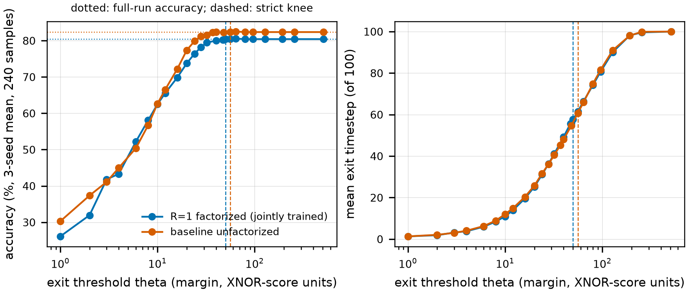

# Phases 2-4 report - the HDC query stage, the integration, and margin-based early termination

Tags: **[RTL]** measured on the RTL regression (Verilator and Icarus, every timestep compared with the reference), **[REF]** computed by the Phase 0/2-4 integer reference, **[SW]** the software study (`studies/algorithm/phase3_experiments`), **[ASSUM]** assumed, **[CHOICE]** a design decision. Every number below is read from `results/hdc/*.json`, the canonical logs and the comparison files by `scripts/hdc_tables.py` + `scripts/make_report_hdc.py`; commands in section 9. Written for the project owner; the synthesis, power and the ablation table (energy and area) are in [`phase5_ppa.md`](phase5_ppa.md).

## 0. The answer

- **Both class-hypervector mappings are built, selectable by a parameter, and bit-exact against the reference at every timestep prefix** (240 DVS-Gesture samples x 3 seeds x 100 timesteps, 2160 sample-runs, 0 mismatching) [RTL]. **The factorized mapping produces IDENTICAL scores to the unfactorized one - not close, identical:** 72,000 timesteps compared line by line (spikes, X, V, the 10 prefix scores, leader, second score, cycles), 0 differences. The factorization is lossless for the R=1 class hypervector it represents; what it costs is the *model*: rank 1 is a different, jointly trained network, 80.42% against 82.36% for the unfactorized baseline (3-seed means, full run).
- **The two numbers that justify the factorization** (section 2.5): macro count **16 -> 1** (128 x 128 macros; 4 -> 1 on this design's 512 x 32 macros) and row activation **0.422% -> 42.2%** of the rows (measured on the RTL: 8.45 rows gated per timestep for the baseline's spikes; the R=1 model fires more, 8.13, giving 0.406% -> 40.6%). Storage 20,000 -> 1,250 bits.
- **Integration (section 3): no FIFO is needed.** The event intake of 1E's SNN is already a stall-never-buffer valid/ready; the integration holds it (`ingest_en`) from the spike strobe until the query has scored the timestep and the exit decision is taken - **5 cycles per timestep, 500 per inference** - and for good after an exit. Per inference at g = 8 (all 160 columns per read): 463,013 cycles = 407,124 event ingest + 500 query + 55,390 SNN MVM stalls; the query stage is 0.108% of the time.
- **Early exit (section 4): accuracy intact at a mean exit of timestep 57.6 (R=1 model, threshold 50) / 60.7 (unfactorized baseline, threshold 56), i.e. 42.4% / 39.3% of the timesteps - and of the events - never ingested.** The knee is the smallest threshold at which the 3-seed accuracy equals the full-run accuracy and stays there for every larger threshold; allowing one sample (0.14 pp) the knee moves to 47 / 37 (mean exit 55.6 / 45.3). The threshold is in XNOR-score units; the software study's bipolar threshold is twice it. **Hardware and reference agree on all 153 (model, seed, threshold) points: True**, and the reference reproduces the stored software sweep exactly (section 4.4).
- **Early exit disabled costs nothing and changes nothing** (Phase 4 requirement ii): with the comparator built and the threshold at its 'never' value, the run is byte-identical to the build without the comparator - 144,000 timesteps compared, 0 differences, cycles included.
- **1E's RTL is unchanged** (`git diff` of `rtl/phase1_snn` and `rtl/pkg/cim_neurohdc_pkg.sv` is empty; section 7). One thing 1E's controller cannot do is *abort*: after an early exit the SNN is parked in INGEST and the next sample needs a reset and a weight reload; the testbench does that and reports the reload separately. This is the one follow-up the early exit asks of 1E (section 8).

## 1. Completion criteria

| criterion | status | evidence |
|---|---|---|
| the reference is extended before each RTL block | PASS | `hdc_query.py`, `r1_model.py`, `tests/test_hdc_query.py` (10 tests + the Phase 0 ones, all pass) exist before any Phase 2-4 RTL; the unit and regression tests import them (section 2.2) |
| both class-HV mappings build and produce identical scores | PASS | `fu_s0..2`: 72,000 timesteps identical (section 2.4) |
| all four ablation configurations elaborate and pass | PASS | section 5 |
| early exit disabled is bit-identical to Phase 3 | PASS | `dis_*`: 144,000 timesteps, 0 differences (section 4.3) |
| every RTL result confirmed on both Verilator and Icarus | see 6 | 29 twin runs compared per timestep, plus the cocotb unit tests on both (section 6) |
| 1E's RTL is unchanged and its regression still passes | PASS | empty `git diff`; the 1E recheck is in section 7 |
| the generated netlist agrees with the mesh solver to 1C's tolerance | see report | [`crossbar_netlist.md`](crossbar_netlist.md) |
| Phase 5 energy is reported at the measured exit timestep | see report | [`phase5_ppa.md`](phase5_ppa.md) |

## 2. Phase 2 - the HDC query stage

### 2.1 What was built

Input: the 20-bit spike vector of one timestep, with a one-cycle valid strobe and the timestep index (`spike_valid_o`, `spike_o`, `spike_tstep_o` of `snn_top`). Output: N = 10 prefix scores, the leader and the second-largest score, once per timestep. The two mappings sit behind one interface and are selected by the parameter `FACTORIZED`.

| block | file | does |
|---|---|---|
| class-HV array, both mappings | `rtl/phase2_hdc/hdc_class_array.sv` | behavioural model of the CIM array (a black box in synthesis, like `cim_macro`). FACTORIZED: the stationary 20 x N array; one read with the spikes on the row lines (**spike-gated row enable**) and all N columns sensed returns q_i = popcount(S & a_i). Unfactorized: the 2000 x N memory; a read returns the N class slices of timestep t |
| datapath (a) XNOR-popcount | `hdc_score.sv` | agree_i = popcount(~(S ^ slice_i)), 0..20 |
| datapath (b) AND-popcount + sign | `hdc_score.sv` | P_i = 20 - |S| - bias_i + 2 q_i (the XNOR popcount of S with a_i; **bias_i = ||a_i||_1** is the per-class bias register); agree_i = b_i[t] ? P_i : 20 - P_i (sign table, T x N bits) |
| N score accumulators | `hdc_query.sv` | N x 11-bit, cleared at sample start, one add per class per timestep |
| top-2 selection, argmax | `top2_tree.sv` | binary tournament of pairwise merges, ceil(log2 N) = 4 levels, no sort; ties keep the lower class index; two tied leaders give margin 0 |
| class image port | `hdc_pkg.sv` | static, like 1E's weight image: sel 0 = array (100 words of N x 20 bits unfactorized, 1 word factorized), sel 1 = sign table, sel 2 = bias registers |

Pipeline (the same for both mappings): cycle 0 spike strobe and capture; 1 array read; 2 agree and accumulate; 3 top-2; 4 decision valid. `busy` covers cycles 0-4, so the integration holds the SNN for 5 cycles per timestep (section 3). Simulation-only checks inside `hdc_query` (never disabled in a run): every agree in 0..20, no spike vector arriving while the previous timestep is in flight, and the **unipolar identity of the README (Phase 2 task 2)** - the argmax of the prefix `2 S.C_i - ||C_i||_1` equals the XNOR leader at *every* timestep, and exactly `score_i = unipolar_i + sum_t (20 - |S_t|)` - computed from an independent shadow copy of the class image. 0 assertion messages in every run of every build.

### 2.2 The reference, extended first

`design/reference_model/model/fixedpoint/hdc_query.py` (integer arithmetic only) defines, before any RTL existed: the score (`agree_unfactorized` = Phase 0's XNOR popcount), the R=1 expansion C_i[t,j] = XNOR(a_i[j], b_i[t]), the factorized form (`agree_factorized`: AND-popcount + bias + sign), the tournament top-2, the margin, the exit rule (`exit_point`), the unipolar identity and the sweep. `tests/test_hdc_query.py` proves, on random data and on the golden rasters: factorized == unfactorized on the expansion (densities 0..1), the unipolar identity *exactly* (not just argmax), the tournament equals a sort with forced ties, the exit semantics (the prediction is the argmax *of the exit timestep*, not of the final scores), the bipolar-to-integer threshold translation is exact, and the replay of the stored software sweep (section 4.4). `r1_model.py` extracts the integer R=1 models and exports their golden vectors (`tb/vectors/dvsgesture/r1_seed<k>.npz`, weights tag `r1s<k>`).

**The R=1 checkpoints are a different network, not a compression of the baseline.** `studies/algorithm/phase3_experiments` trained them jointly (SNN weights, threshold and the factors A [N,1,20], B [N,1,100]) from an SVD initialisation of the baseline's class hypervector. The integer pipeline reproduces each checkpoint's recorded float test accuracy exactly:

| R=1 seed | integer pipeline | recorded float test_acc | factorized == unfactorized scores |
|---|---|---|---|
| 0 | 80.83% (194/240) | 80.83% | all 24,000 prefixes |
| 1 | 81.67% (196/240) | 81.67% | all 24,000 prefixes |
| 2 | 78.75% (189/240) | 78.75% | all 24,000 prefixes |

The frozen widths hold for these networks too (measured on the 240 test samples): |X| <= 697,371 (W_X = 21 bits: 1,048,575), V down to -29,470,256 (W_V = 26 bits: 33,554,431 - **12 % headroom on seed 2**, the tightest margin of the whole datapath), thresholds 5,891..14,974 (W_THRESH = 15 bits: 16,383).

### 2.3 Class image sizes

|  | unfactorized | R=1 factorized |
|---|---|---|
| stationary array | - | 20 x 10 = 200 bits (ReRAM) |
| class memory | 2000 x 10 = 20,000 bits (ReRAM) | - |
| sign table | - | 100 x 10 = 1,000 bits (digital flip-flops) |
| per-class bias registers | - | 10 x 5 = 50 bits (digital) |
| total | 20,000 | 1,250 (the README's 120 x N = 1,200 plus the bias registers) |

### 2.4 Bit-exactness and the identity of the two mappings

| run (early exit not built) | seed | samples | mismatching vs reference | assertion msgs | accuracy | cycles / inference |
|---|---|---|---|---|---|---|
| unfactorized RTL, baseline model | 0 | 240 | 0 | 0 | 84.58% | 463,013 |
| factorized RTL, R=1 model | 0 | 240 | 0 | 0 | 80.83% | 463,013 |
| unfactorized RTL, R=1 model expanded | 0 | 240 | 0 | 0 | 80.83% | 463,013 |
| unfactorized RTL, baseline model | 1 | 240 | 0 | 0 | 82.92% | 463,013 |
| factorized RTL, R=1 model | 1 | 240 | 0 | 0 | 81.67% | 463,013 |
| unfactorized RTL, R=1 model expanded | 1 | 240 | 0 | 0 | 81.67% | 463,013 |
| unfactorized RTL, baseline model | 2 | 240 | 0 | 0 | 79.58% | 463,013 |
| factorized RTL, R=1 model | 2 | 240 | 0 | 0 | 78.75% | 463,013 |
| unfactorized RTL, R=1 model expanded | 2 | 240 | 0 | 0 | 78.75% | 463,013 |

Per sample and per timestep the testbench compares spikes, X, V (the 1E checks), the 10 prefix scores, the leader, the second-largest score, the fire flag, the rows gated and the SNN access counters (1E's criterion 7), and per sample the prediction, the exit timestep, the events ingested and the query cycles (exactly 5 per timestep). **A mismatch anywhere fails the run.**

| comparison (canonical per-timestep logs, line by line) | seed | timesteps | differences |
|---|---|---|---|
| factorized RTL vs unfactorized RTL with the expanded class HV (reload cycles aside) | 0 | 24,000 | 0 |
| factorized RTL vs unfactorized RTL with the expanded class HV (reload cycles aside) | 1 | 24,000 | 0 |
| factorized RTL vs unfactorized RTL with the expanded class HV (reload cycles aside) | 2 | 24,000 | 0 |

The two mappings differ in the data path and in the cycle accounting of the *reload* (the class image is 2 words of 1,250 bits against 100 words of 200) - nothing else. That answers the brief's question: the factorization is **not lossy** for the class hypervector it stores, and there is no bug. The accuracy gap is the cost of constraining the class hypervector to rank 1, paid at training time.

### 2.5 The two numbers

|  | unfactorized | R=1 factorized | source |
|---|---|---|---|
| macros (128 x 128, README Exp 1b) | 16 | 1 | [REF] ceil(2000/128) x ceil(10/128) vs ceil(20/128) x 1; matches `exp1b_analytic.csv` |
| macros on this design's 512 x 32 macro | 4 | 1 | [REF] ceil(2000/512) vs 1 |
| rows gated per timestep, baseline model (mean of 3 seeds) | 8.447 of 2000 rows = 0.422% | 8.447 of 20 rows = 42.24% | [RTL] `rows_gated`, = mean spikes per timestep; README's 0.38 % -> 37.5 % is the seed-0 value 7.51 |
| rows gated per timestep, R=1 model (mean of 3 seeds) | 8.129 of 2000 = 0.406% | 8.129 of 20 = 40.64% | [RTL] |
| bits read per timestep | 200 (10 classes x 20 bits) | 20 (10 array outputs + 10 sign bits) | [REF] |
| class image bits | 20,000 | 1,250 | section 2.3 |

The unfactorized datapath here is the literal XNOR-popcount of the 20-bit slices (a digital read of 200 bits); the row-activation figure is the spike-gated one the README quotes. Phase 5 prices the array reads on that basis ([`phase5_ppa.md`](phase5_ppa.md)).

## 3. Phase 3 - the integration

```
  events --> [snn_top] --spike_o/spike_valid_o/spike_tstep_o--> [hdc_query] --leader, top1, top2--> [exit_ctrl] --> prediction
                 ^   ingest_en_i = external enable AND NOT query busy AND NOT exited   <--------------+
```

- **Top level through the 20-bit interface:** `rtl/phase3_top/cim_neurohdc_top.sv` instantiates `snn_top` unchanged and connects its spike port to the query stage; one configuration bus (7-bit address; 0-31 are 1E's registers, 32 = threshold, 33 = exit enable) and one class-image port.
- **Handshake and backpressure.** `snn_top` has a valid strobe and no ready input; what it has is the event-intake gate. The integration drives it low from the strobe cycle until the decision is taken and for good after an exit, so back-pressure reaches the event source through `ev_ready` exactly as in 1E. Nothing is buffered, no event can be lost: the 1E assertions (every event counted once, counters sum to the timestep's event count) pass in every run, and `hdc_query` asserts that no spike vector arrives while the previous timestep is in flight.
- **Timestep synchronisation.** The query consumes timestep t's spikes before any event of timestep t+1 is accepted *by construction* (the intake is closed for strobe + 4 cycles), and the exit decision is taken before the next event - otherwise the saving would be partly an illusion. The measured query cost is exactly 5 cycles per timestep (asserted per sample).
- **Shared configuration and control:** thresholds, geometry and the event count as in 1E; plus the exit threshold register (reset value 'never' = 4095) and a runtime exit enable.
- **An input FIFO: not needed.** The handshake is lossless without one. A FIFO would be needed only if the event source cannot be stalled (a live sensor delivering at its own rate while the SNN is busy for 554 cycles per timestep on average); that is a system decision about the sensor interface, not something the handshake requires, and it is listed in the open items.

### 3.1 Cycles per inference, split between event ingest and query

| early exit not built, g = 8, 160 columns per read | event ingest (1 cycle per event) | SNN MVM + update + wipe (stall) | query (5 per timestep) | total | query share | at 100 MHz |
|---|---|---|---|---|---|---|
| baseline model, unfactorized RTL | 407,124 | 55,390 | 500 | 463,013 | 0.108% | 4.63 ms |
| R=1 model, factorized RTL | 407,124 | 55,390 | 500 | 463,013 | 0.108% | 4.63 ms |

The design is input-bound (1E's finding): events dominate; the query stage adds 500 cycles, 0.1 %. The 1E-only cycle count at g = 8 was 462,617 (seed-independent: it depends on the inputs only); here the same inputs give the same ingest and stall cycles plus the query's 500.

## 4. Phase 4 - margin-based early termination

**Top-2 without a sort.** `top2_tree.sv`: 9 merge nodes for N = 10, depth 4; each node is one comparison and one second-value update (`merge(l, r)`: if l.v >= r.v the leader is l and the second is max(l.v2, r.v), else symmetric). Verified against a sort with forced ties, all-equal, all-zero and every pair of tied leaders for N = 7, 10, 16, 24 on both simulators (cocotb), and inside every regression timestep against the reference tournament. **Margin comparator:** margin = top1 - top2 against the 12-bit threshold register (`exit_ctrl.sv`); the boundary cases margin = theta - 1, theta, theta + 1 are unit-tested (fires exactly at >= theta). **Exit FSM:** on the decision cycle, `fire` latches the prediction (the leader of *that* timestep), the exit timestep and the early flag, raises `exited`, and the integration keeps the event intake closed; the last timestep finishes the inference without being an exit. Instrumentation: `events_ingested` counts accepted events, compared per sample with the reference's bin sizes up to the exit timestep.

**Correctness requirements, proven rather than assumed.**

1. *The prediction emitted at exit equals the argmax at that timestep.* Checked on every sample of every run (3948 sample-runs at the named runs plus the whole sweep): the emitted class equals the reference's argmax of the prefix scores at the exit timestep (the unit test uses a case where it differs from the final argmax).
2. *With the threshold at 'never', behaviour is bit-identical to Phase 3.* 144,000 timesteps over 6 runs (baseline and R=1, 3 seeds), the comparator built vs not built, line by line: 0 differences.

### 4.1 Hardware sweep: accuracy and mean exit timestep against the threshold

Threshold in XNOR-score margin units (software bipolar threshold / 2). Mean of 3 seeds, all 240 test samples, RTL; 'ref' = the integer reference, which agrees on every point.

| theta | R=1 factorized: accuracy / mean exit timestep / events ingested | baseline unfactorized: accuracy / mean exit timestep / events ingested | RTL == reference |
|---|---|---|---|
| 1 | 26.11% / 1.3 / 1.3% | 30.28% / 1.3 / 1.3% | yes |
| 2 | 31.94% / 1.9 / 1.9% | 37.36% / 2.1 / 2.1% | yes |
| 3 | 41.81% / 3.2 / 3.2% | 41.11% / 3.0 / 3.0% | yes |
| 4 | 43.33% / 3.8 / 3.8% | 45.00% / 4.0 / 4.0% | yes |
| 6 | 52.22% / 5.9 / 5.9% | 50.42% / 6.3 / 6.3% | yes |
| 8 | 58.06% / 8.4 / 8.4% | 56.67% / 8.9 / 8.9% | yes |
| 10 | 62.50% / 11.0 / 11.0% | 62.64% / 12.0 / 12.0% | yes |
| 12 | 65.56% / 13.8 / 13.8% | 66.53% / 14.8 / 14.8% | yes |
| 16 | 69.86% / 19.6 / 19.6% | 72.22% / 20.4 / 20.4% | yes |
| 20 | 73.75% / 25.2 / 25.2% | 77.36% / 25.8 / 25.8% | yes |
| 24 | 76.39% / 31.1 / 31.1% | 79.86% / 31.6 / 31.6% | yes |
| 28 | 78.19% / 36.3 / 36.3% | 81.25% / 36.1 / 36.1% | yes |
| 32 | 79.44% / 41.1 / 41.1% | 81.53% / 40.5 / 40.5% | yes |
| 37 | - | 82.22% / 45.3 / 45.3% | yes |
| 40 | 80.00% / 49.2 / 49.2% | 82.36% / 48.0 / 48.0% | yes |
| 47 | 80.28% / 55.6 / 55.6% | - | yes |
| 48 | 80.28% / 55.9 / 55.9% | 82.22% / 54.7 / 54.7% | yes |
| 50 | 80.42% / 57.6 / 57.6% | - | yes |
| 56 | 80.42% / 61.5 / 61.5% | 82.36% / 60.7 / 60.7% | yes |
| 64 | 80.56% / 66.3 / 66.3% | 82.50% / 65.9 / 65.9% | yes |
| 80 | 80.42% / 74.2 / 74.2% | 82.36% / 74.8 / 74.8% | yes |
| 96 | 80.42% / 80.7 / 80.7% | 82.36% / 81.5 / 81.5% | yes |
| 128 | 80.42% / 90.1 / 90.1% | 82.36% / 91.0 / 91.0% | yes |
| 192 | 80.42% / 98.2 / 98.2% | 82.36% / 98.1 / 98.1% | yes |
| 256 | 80.42% / 99.6 / 99.6% | 82.36% / 99.9 / 99.9% | yes |
| 512 | 80.42% / 100.0 / 100.0% | 82.36% / 100.0 / 100.0% | yes |
| 4095 (never) | 80.42% / 100.0 / 100.0% | 82.36% / 100.0 / 100.0% | yes |



*Figure 30.* Accuracy (left) and mean exit timestep (right) against the margin threshold, RTL, mean of 3 seeds; the knees are marked.

### 4.2 The knee

| model | knee criterion | theta | accuracy (3-seed mean) | mean exit timestep | timesteps saved | accuracy per seed |
|---|---|---|---|---|---|---|
| R=1 factorized | accuracy >= full-run accuracy at this threshold and at every larger one | 50 | 80.42% | 57.61 | 42.4% | 81.25/81.67/78.33 |
| R=1 factorized | within one test sample (0.14 pp) | 47 | 80.28% | 55.62 | 44.4% | 80.83/81.67/78.33 |
| R=1 factorized | within 0.5 pp | 43 | 80.00% | 52.33 | 47.7% | 80.42/81.25/78.33 |
| R=1 factorized | within 1 pp | 32 | 79.44% | 41.05 | 58.9% | 79.17/81.67/77.50 |
| R=1 factorized | full run (no exit) | - | 80.42% | 100.00 | 0.0% | 80.83/81.67/78.75 |
| baseline unfactorized | accuracy >= full-run accuracy at this threshold and at every larger one | 56 | 82.36% | 60.72 | 39.3% | 84.58/82.50/80.00 |
| baseline unfactorized | within one test sample (0.14 pp) | 37 | 82.22% | 45.27 | 54.7% | 84.17/82.50/80.00 |
| baseline unfactorized | within 0.5 pp | 34 | 81.94% | 42.50 | 57.5% | 84.17/82.08/79.58 |
| baseline unfactorized | within 1 pp | 29 | 81.39% | 37.38 | 62.6% | 83.75/80.83/79.58 |
| baseline unfactorized | full run (no exit) | - | 82.36% | 100.00 | 0.0% | 84.58/82.92/79.58 |

**The knee is theta = 50 for the R=1 model and 56 for the baseline** (strict criterion): accuracy intact, mean exit timestep 57.6 / 60.7. Accuracy is flat to within one sample from theta ~ 47 / 37 upward, so the curve is a plateau, not a cliff, and a threshold a little below the strict knee costs a fraction of a sample. **Caveat:** the thresholds were chosen on the 240 test samples that also report the accuracy (the project has no held-out raster set for the R=1 networks); a validation-based choice is an open item.

### 4.3 Early exit disabled == Phase 3

| comparison | seed | timesteps | differences |
|---|---|---|---|
| unfactorized baseline: comparator built, theta = never vs not built | 0 | 24,000 | 0 |
| unfactorized baseline: comparator built, theta = never vs not built | 1 | 24,000 | 0 |
| unfactorized baseline: comparator built, theta = never vs not built | 2 | 24,000 | 0 |
| factorized R=1: comparator built, theta = never vs not built | 0 | 24,000 | 0 |
| factorized R=1: comparator built, theta = never vs not built | 1 | 24,000 | 0 |
| factorized R=1: comparator built, theta = never vs not built | 2 | 24,000 | 0 |

### 4.4 Against the software study

`hdc_query.sweep` (the reference) reproduces `exp2_early_exit.json` - accuracy and mean exit timestep at all 11 stored thresholds for the three baseline seeds - exactly (`tests/test_hdc_query.py`, bipolar theta = 2 x integer theta), and the RTL reproduces the reference at every swept point. The README's check point 'bipolar theta = 128 with no accuracy loss and about 68 % of the events ingested' is integer theta = 64: 
RTL, baseline, 3-seed mean: accuracy 82.50% (full run 82.36%), events ingested 65.9% (34.1% saved; the README's 67.9 % / 32.1 % is the seed-0 figure).

## 5. The four ablation builds

`cim_neurohdc_top` elaborates and passes in all four configurations; they are two parameters, not edits. Evidence per build:

| build | parameters | `verilator -Wall` | Yosys elaboration | regression at its operating threshold, g = 8 (3 seeds) | accuracy | mean exit timestep |
|---|---|---|---|---|---|---|
| full design | FACTORIZED=1, EARLY_EXIT_EN=1 | clean | check -assert PASS, 0 latches | 720 samples, 0 mismatching | 80.42% | 57.6 |
| early exit OFF | FACTORIZED=1, EARLY_EXIT_EN=0 | clean | check -assert PASS, 0 latches | 720 samples, 0 mismatching | 80.42% | 100.0 |
| factorization OFF | FACTORIZED=0, EARLY_EXIT_EN=1 | clean | check -assert PASS, 0 latches | 720 samples, 0 mismatching | 82.36% | 60.7 |
| both OFF | FACTORIZED=0, EARLY_EXIT_EN=0 | clean | check -assert PASS, 0 latches | 720 samples, 0 mismatching | 82.36% | 100.0 |

(Operating threshold: the strict knee of the model the build uses; early-exit-off builds run to the end. The ablation table with energy and area is in [`phase5_ppa.md`](phase5_ppa.md).)

## 6. Verilator and Icarus

| configuration (identical stimulus on both simulators) | timesteps compared | differences |
|---|---|---|
| ab_bothoff_g4_s0 | 2,400 | 0 |
| ab_eeoff_g4_s0 | 2,400 | 0 |
| ab_factoff_g4_s0 | 1,351 | 0 |
| ab_full_g4_s0 | 1,205 | 0 |
| c20_check_s0 | 1,094 | 1 |
| dis_base_s0 | 2,400 | 0 |
| dis_base_s1 | 2,400 | 0 |
| dis_base_s2 | 2,400 | 0 |
| dis_r1fact_s0 | 2,400 | 0 |
| dis_r1fact_s1 | 2,400 | 0 |
| dis_r1fact_s2 | 2,400 | 0 |
| l4_real_gaps_s0 | 1,173 | 0 |
| l4_shuffled_nogap_s0 | 1,326 | 0 |
| l4_sorted_gaps_s0 | 1,376 | 0 |
| p3_base_s0 | 2,400 | 0 |
| p3_base_s1 | 2,400 | 0 |
| p3_base_s2 | 2,400 | 0 |
| p3_r1fact_s0 | 2,400 | 0 |
| p3_r1fact_s1 | 2,400 | 0 |
| p3_r1fact_s2 | 2,400 | 0 |
| p3_r1unfact_s0 | 2,400 | 0 |
| p3_r1unfact_s1 | 2,400 | 0 |
| p3_r1unfact_s2 | 2,400 | 0 |
| sw_base_s0_t40 | 1,326 | 0 |
| sw_base_s0_t56 | 1,678 | 0 |
| sw_base_s0_t8 | 255 | 0 |
| sw_r1fact_s0_t40 | 1,039 | 0 |
| sw_r1fact_s0_t56 | 1,376 | 0 |
| sw_r1fact_s0_t8 | 232 | 0 |

Total 54,231 timesteps, 1 differences. The Icarus profile is a fixed random subset of the rows per configuration (Icarus is ~50x slower than Verilator); each is compared with a Verilator twin of identical arguments, so the stimulus is identical.

The cocotb unit tests of the new blocks (`top2_tree` N = 7/10/16/24, `exit_ctrl` with and without the comparator, `hdc_query` for both mappings) pass on both simulators:

| case | Verilator | Icarus |
|---|---|---|
| exit_ctrl_ee0 | PASS | PASS |
| exit_ctrl_ee1 | PASS | PASS |
| hdc_query_f0 | PASS | PASS |
| hdc_query_f0_n24 | PASS | PASS |
| hdc_query_f1 | PASS | PASS |
| hdc_query_f1_n24 | PASS | PASS |
| top2_tree_n10 | PASS | PASS |
| top2_tree_n16 | PASS | PASS |
| top2_tree_n24 | PASS | PASS |
| top2_tree_n7 | PASS | PASS |

## 7. Phase 1E is untouched

```
git diff --stat -- design/rtl/rtl/phase1_snn design/rtl/rtl/pkg/cim_neurohdc_pkg.sv   ->  (empty)
```

1E regression RE-RUN with the Phase 2-5 tree in place (same 19 configurations as `scripts/run_all_regressions.sh`, tags `recheck_*`, tracked 1E results untouched; Verilator): 19 runs, 5,604 samples, 0 mismatching, 0 access-estimate mismatches, 0 assertion messages.

| run | samples | mismatching |
|---|---|---|
| dvs_seed0_g16_c160 | 240 | 0 |
| dvs_seed0_g32_c160 | 240 | 0 |
| dvs_seed0_g4_c160 | 240 | 0 |
| dvs_seed0_g64_c160 | 240 | 0 |
| dvs_seed0_g64_c20 | 240 | 0 |
| dvs_seed0_g8_c160 | 240 | 0 |
| dvs_seed0_g8_c20 | 240 | 0 |
| dvs_seed0_g8_noskip | 240 | 0 |
| dvs_seed0_level4_real_gaps | 20 | 0 |
| dvs_seed0_level4_shuffled_gaps | 48 | 0 |
| dvs_seed0_level4_sorted_gaps | 48 | 0 |
| dvs_seed1_g8_c160 | 240 | 0 |
| dvs_seed1_level4_real_gaps | 20 | 0 |
| dvs_seed1_level4_sorted_nogap | 48 | 0 |
| dvs_seed2_g8_c160 | 240 | 0 |
| dvs_seed2_level4_real_gaps | 20 | 0 |
| nmnist_seed0_g64 | 1000 | 0 |
| nmnist_seed0_g8 | 1000 | 0 |
| nmnist_seed0_g8_gaps | 1000 | 0 |

Full unit-test suite (1E's 31 cases + the new blocks) on both simulators, rerun with the Phase 2-5 tree: 82 of 82 cases PASS (`results/phase234_1e_recheck/unit_tests/`).

## 8. Assumptions and open items (updated TO BE DETERMINED list)

- **An abort in 1E's controller.** After an early exit `snn_ctrl` is parked in INGEST; the next sample needs a reset and a weight reload (2,560 cycles through `weight_load` in this model, plus the class image). The testbench does both and reports `reload_cycles` separately; they are *not* part of an inference. A real part keeps its weights (ReRAM) and needs only a 2-state abort input to `snn_ctrl` (return to IDLE/DONE and clear the counters). Recorded for the 1E follow-up, not done here (1E is frozen).
- **Threshold selection on the test set.** The knee is picked on the same 240 samples that report the accuracy; no held-out rasters exist for the R=1 networks. Open: choose theta on a validation split (needs validation spike rasters from the training scripts).
- **N-MNIST** was not run through the query stage: no class hypervector or R=1 network exists for it in the vectors (Phase 6 must report dataset dependence; the SNN side is exact on N-MNIST since 1E).
- **The R=1 network is a different model** (jointly trained, 80.4 % against 82.4 %, 3-seed means, full run): the cost of the factorization is paid in accuracy at training time, not in hardware. Higher ranks (R = 2..16) are not built; the mapping is rank 1 only (a rank-R array is a different `hdc_class_array`).
- **A live sensor** needs an input FIFO (or a stall-tolerant source) if events arrive faster than 1 per cycle between MVMs; the SNN is busy ~5-8 % of the time. Not designed: 1E's source is replayed and stalled.
- **The class-HV arrays are behavioural** (like the SNN crossbar in 1E): their analog design, margin and sensing for 10 columns are not done; Phase 5 prices them by scaling 1F's per-column read cost and 1C's area parts ([ASSUM]).
- **Ties.** The leader of a tie is the lowest class index everywhere (reference, RTL, tournament); the margin of a tie is 0, so a tie can never trigger an exit with theta >= 1.
- **Verible** is not installed on this machine; the new files are `verilator -Wall` clean only (section 1 of `results/lint/lint_hdc.log`).
- **Widths.** The frozen W_V = 26 holds for all three R=1 networks but with only 12 % headroom on seed 2 (section 2.2); a different checkpoint could overflow it silently - the simulation asserts in 1E would catch it.

## 9. Reproduce

```
design/rtl/scripts/run_hdc_everything.sh              # everything (hours); stages log to design/rtl/results/logs/
venv/bin/python design/rtl/scripts/hdc_tables.py && venv/bin/python design/rtl/scripts/make_report_hdc.py     # only this report, from the runs on disk
```
